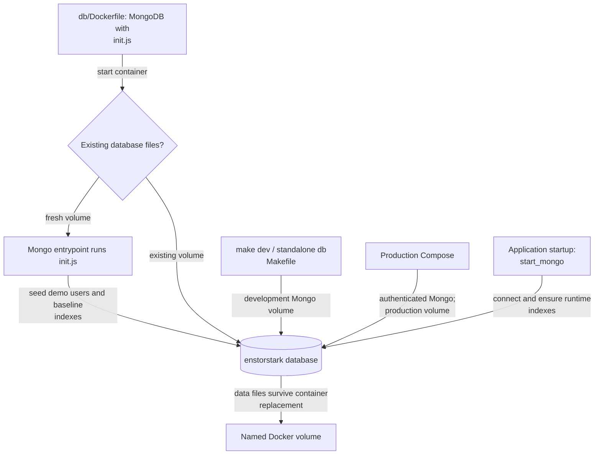

# MongoDB setup

This folder contains the MongoDB image for production, local development, and CI.

`make dev` in the repository root already starts this database together with the app, and
needs no Node.js on the host. The commands below are for running only the database, with
the app started separately through npm.

[Repository overview](../README.md#architecture) · [Stored data and application connection](../src/lib/db/README.md) ·
[Deployment runbook](../docs/deployment.md)

## Initialization and persistence



`init.js` runs only on a fresh database directory. Application startup separately ensures runtime
indexes, including audit and quota TTL indexes; it does not recreate demo accounts on each request.
The [development Compose stack](../docker-compose.dev.yml), [standalone Makefile](Makefile), and
[production Compose stack](../docker-compose.yml) use their own volume definitions. Starting one
does not copy data from another. CI uses disposable storage.

The same database image seeds demo application accounts on a fresh production volume. Database
authentication does not disable those logins; follow the existing production notes below before
exposing a new deployment. Review images are stored separately from MongoDB, so recovery needs
both database and image backups.

## Run from repo root

The easiest way is to run the npm scripts from the repository root:

```bash
npm run db:all
```

Available commands:

- `npm run db:build` - build MongoDB image
- `npm run db:run` - run container with persistent volume
- `npm run db:prepare` - ensure the `admin` user with password `administrator` exists
- `npm run db:all` - run + prepare
- `npm run db:clean` - stop container and remove image
- `npm run db:reset` - clean + delete persistent volume

The underlying Makefile still exists in this folder and can also be called directly.

## Production compose auth

The root `docker-compose.yml` is configured for authenticated MongoDB in deployment scenarios.

Required variables are documented in `.env.example`:

- `MONGO_ROOT_USERNAME`
- `MONGO_ROOT_PASSWORD`
- `APP_MONGO_URI`
- `REVIEW_REQUEST_DISCORD_WEBHOOK_URL` (production delivery, kept out of committed files)

Example flow from repo root:

```bash
cp .env.example .env
# edit .env with strong secrets
docker compose up -d --build
docker compose exec app npm run create-user <username> <password>
```

Production initializes the database indexes without creating any application users. Create
accounts explicitly with the command above, which uses the app container's configured MongoDB
connection. MongoDB's root account is separate from application login and is still created by
the official entrypoint using the configured credentials.

Note: with authentication enabled, any script/tool connecting to MongoDB must use a URI with credentials and `authSource=admin`.

Production container logs rotate automatically, retaining approximately 100 MB per service
before compression. Mongo keeps normal diagnostics and checks health every 60 seconds, every second while starting.
Existing Mongo containers need a separate maintenance recreation to apply these settings;
follow [container logging and Mongo maintenance](../docs/deployment.md#container-logging-and-mongo-maintenance)
to preserve the database volume and verify backups before replacement.

## Persistence behavior

The native development commands store data in the `enstorstark-mongodb-data` Docker volume.
The Compose stacks use their own database volumes.

- Use `db:clean` if you want to keep database data.
- Use `db:reset` if you want a full wipe and fresh initialization.

Initialization scripts run only for a fresh data directory. Rebuilding or restarting keeps
existing users, including any demo users seeded by an older production image. This change
does not remove or migrate accounts in existing databases.

## Development demo users

`init.js` creates the bar and map-geocode indexes in every environment. The development image
also includes `seed-dev-users.js` in `/docker-entrypoint-initdb.d/`, so MongoDB's entrypoint
creates these application accounts on first initialization:

Seeded demo users:

- `dj` / `jaeger123`
- `test` / `testpass123`

These are public demo passwords, stored as Argon2 hashes in the database. Development Compose,
CI Compose, and the native database Makefile explicitly build the `development` target.
The native `db:all` command additionally retains its `db:prepare` step, which ensures the local
`admin` / `administrator` application account exists.

## Dockerfile

The Dockerfile uses the official `mongo:7` image. The shared `base` stage contains only `init.js`.
The `development` target adds the demo-user script. The final `production` target inherits only
from `base`, so an ordinary build without `--target` also contains no demo-user script.
Production Compose selects `production` explicitly.
