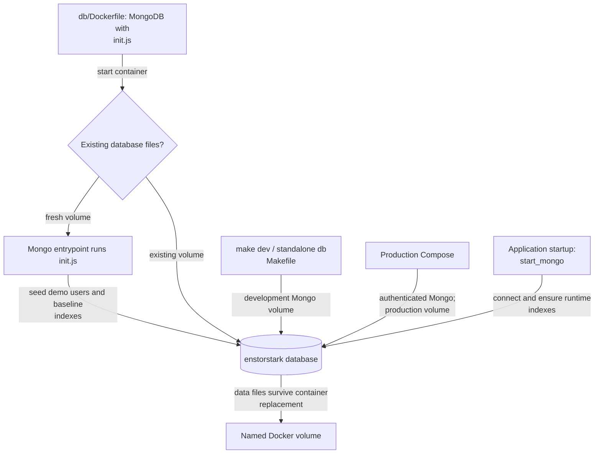

# Simple Docker setup for development MongoDB

This folder contains a small MongoDB Docker setup for local development.

`make dev` in the repository root already starts this database together with the app, and
needs no Node.js on the host. The commands below are for running only the database, with
the app started separately through npm.

[Repository overview](../README.md#architecture) · [Stored data and application connection](../src/lib/db/README.md) ·
[Deployment runbook](../docs/deployment.md)

## Initialization and persistence



`init.js` runs only on a fresh database directory. Application startup separately ensures runtime
indexes, including audit and quota TTL indexes; it does not recreate demo accounts on each request.
The [development Compose stack](../docker-compose.dev.yml), [standalone Makefile](Makefile), and
[production Compose stack](../docker-compose.yml) use their own volume definitions. Starting one
does not copy data from another. CI uses disposable storage.

The same database image seeds demo application accounts on a fresh production volume. Database
authentication does not disable those logins; follow the existing production notes below before
exposing a new deployment. Review images are stored separately from MongoDB, so recovery needs
both database and image backups.

## Run from repo root

The easiest way is to run the npm scripts from the repository root:

```bash
npm run db:all
```

Available commands:

- `npm run db:build` - build MongoDB image
- `npm run db:run` - run container with persistent volume
- `npm run db:prepare` - ensure the `admin` user with password `administrator` exists
- `npm run db:all` - run + prepare
- `npm run db:clean` - stop container and remove image
- `npm run db:reset` - clean + delete persistent volume

The underlying Makefile still exists in this folder and can also be called directly.

## Production compose auth

The root `docker-compose.yml` is configured for authenticated MongoDB in deployment scenarios.

Required variables are documented in `.env.example`:

- `MONGO_ROOT_USERNAME`
- `MONGO_ROOT_PASSWORD`
- `APP_MONGO_URI`
- `REVIEW_REQUEST_DISCORD_WEBHOOK_URL` (production delivery, kept out of committed files)

Example flow from repo root:

```bash
cp .env.example .env
# edit .env with strong secrets
docker compose up -d --build
```

Note: with authentication enabled, any script/tool connecting to MongoDB must use a URI with credentials and `authSource=admin`.

## Persistence behavior

Container data is stored in a Docker volume: `enstorstark-mongodb-data`.

- Use `db:clean` if you want to keep database data.
- Use `db:reset` if you want a full wipe and fresh initialization.

## Demo users from init.js

`init.js` is copied to `/docker-entrypoint-initdb.d/` and is executed by MongoDB's entrypoint on first initialization of a fresh data directory.

Seeded demo users:

- `dj` / `jaeger123`
- `test` / `testpass123`

These are public demo passwords, stored as Argon2 hashes in the database. The same
`db/Dockerfile` is currently used by production compose, so a fresh production volume
also receives these application users. MongoDB authentication protects database access,
not application login. Remove or replace the demo accounts before exposing a fresh
deployment. Automatic production seeding is a separate known issue, outside the API
body-limit, base64, and update-precondition fixes.

## Dockerfile

The Dockerfile only copies `init.js` into the Mongo image startup folder and otherwise uses the official `mongo:7` image.
