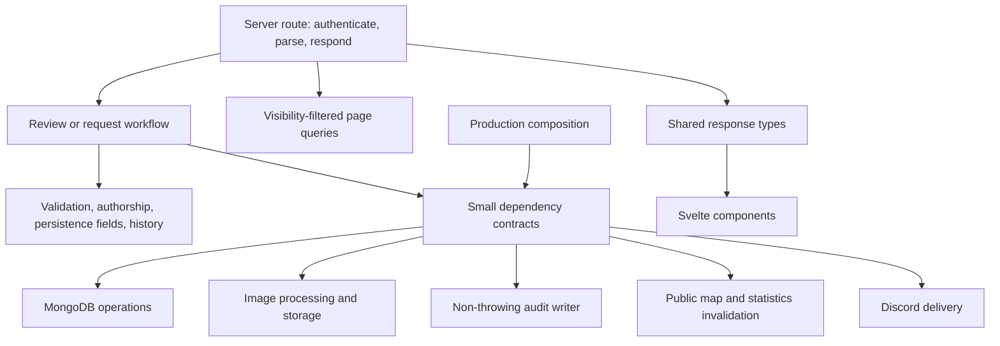

# Architecture and rule ownership

The app uses functions and small dependency contracts. Routes handle SvelteKit requests;
workflows sequence business operations; focused helpers own rules; production adapters supply
MongoDB, image storage, auditing, and external delivery. Browser components never import server
modules, including for shared types.

## Visual reading path

Start with the [root system overview](../README.md#architecture), then follow
[the request lifecycle](../src/README.md) and [route families](../src/routes/README.md).
Use the [library dependency map](../src/lib/README.md) to choose a module boundary.
Local guides explain the current code; this document retains detailed policies and the
[rule-to-test index](#rule-to-test-index).

| Follow a concern                     | Visual guide                                                                                                                                     |
| ------------------------------------ | ------------------------------------------------------------------------------------------------------------------------------------------------ |
| Review writes and lifecycle          | [Create/edit, dependency wiring, publication/deletion](../src/lib/server/reviews/README.md)                                                      |
| Browser interaction                  | [Component composition](../src/lib/components/README.md), [location/image lifecycles](../src/lib/client/README.md)                               |
| Server services and persistence      | [Subsystems, caches, images](../src/lib/server/README.md), [MongoDB relationships](../src/lib/db/README.md)                                      |
| Authentication and external delivery | [Login](../src/lib/server/login/README.md), [review requests](../src/lib/server/review-requests/README.md)                                       |
| Public map                           | [Marker reads and separately admitted geocoding](../src/lib/server/map/README.md)                                                                |
| Native API and app                   | [Contract generation](../openapi/README.md), [API pipeline](../src/lib/server/api/README.md), [mobile modules](../mobile/README.md#architecture) |
| Verification and operations          | [Test layers](../tests/README.md), [CI/deployment](../scripts/README.md), [database initialization](../db/README.md)                             |

## Application boundaries

## Boundaries

Dependency trust boundaries and the reviewed upgrade / override decisions are documented in
[dependency security](dependency-security.md). External map attribution must pass MapLibre's
sanitizer, and session cookie serialization must reject attribute injection. Dependency updates
require a full-tree audit and clean native installation, as well as application regression tests.

CI workflow regressions live in `scripts/ci/`, with adjacent Node tests; the coverage floor is
`coverage.thresholds` in `vite.config.ts`. CI runs for active PRs and main pushes; draft PRs skip
all jobs and becoming ready for review triggers checks. The root-owned
VPS deployment helper lives in `scripts/deploy/`, with Python orchestration regressions and a
disposable Docker backup/restore rehearsal. [Deployment automation](deployment.md) owns the
GitHub rules, credentials, backup consistency, retention, and rollback policy. PR code has no
production credentials; only a successful main-push CI run can invoke the restricted SSH command.
Connection metadata is stored in production environment secrets. The helper accepts only a commit
SHA and reads server settings from a fixed, private root-owned configuration file; it rejects unsafe
configuration before running Git, backups, or Docker. Git uses the existing checkout owner's account,
separately from the restricted CI SSH account.
The server lock protects a persisted five-minute request cooldown before Git/Docker work.
Already-running revisions require a matching image label and successful health checks before
skipping backups/builds/replacement. Failed attempts consume admission, unsafe state fails closed,
and the workflow retries only temporary lock/cooldown rejections with a bounded wait.

- [src/lib/server/reviews/](../src/lib/server/reviews/README.md) contains review rules and create/edit/publish/delete
  workflows. `production.ts` supplies the shared write operations and complete operation-specific
  dependency objects, including database callbacks. Page loads continue to query their collections directly.
- [src/lib/server/map/](../src/lib/server/map/) separates address matching, Nominatim transport, geocode storage,
  marker assembly, and coordination. `review-map.ts` composes one production instance.
- [src/lib/server/review-requests/](../src/lib/server/review-requests/) separates request validation, delivery, rate-limit policy,
  and the submission workflow. The `/about` route keeps origin checks, parsing, and HTTP responses;
  the API route admits its IP before JSON parsing and passes that admission into the workflow.
- [src/lib/server/login/](../src/lib/server/login/) owns credential verification, the dependency-free
  password policy, quota order, auditing, and session creation. Production dependencies connect
  those operations to MongoDB and Lucia. The web route owns cookie transport and redirects;
  the API route owns pre-parser admission and bearer-token responses.
- [src/lib/server/review-feed.ts](../src/lib/server/review-feed.ts) loads projected public reviews, derives
  publication dates from history, and builds RSS with stable review IDs. `/feed.xml` owns HTTP
  responses, including five-minute caching, ETags, conditional requests, and uncached failures.
  RSS anchors use `data-sveltekit-reload` so navigation and hover preloading cannot treat the
  endpoint as a review page through the client router's dynamic slug route.
- [src/lib/types/](../src/lib/types/) contains shared data contracts. `BarReviewUpdate` allows only editable
  review fields, an optional replacement image, and the update time. Publication has a separate
  update contract.
- [src/lib/components/review-form/](../src/lib/components/review-form/) owns the individual beer, attribute, author, rating, and image controls.
- [src/lib/components/ReviewImage.svelte](../src/lib/components/ReviewImage.svelte) renders
  server-provided compressed previews for home cards and detail photos. Native images preserve
  square crops and focus coordinates; the detail photo and first card load eagerly, with later
  cards loading lazily. [src/lib/client/review-image-loading.ts](../src/lib/client/review-image-loading.ts)
  waits for visible previews and the initial page load, then downloads visible originals at low
  priority, one at a time. An original replaces its preview only after decoding; failure keeps
  a successful preview, and navigation or source changes dispose observers and pending work.
  Without scripts previews remain visible. Blob and external URLs retain their existing behavior.
- [src/lib/components/ReviewWizard.svelte](../src/lib/components/ReviewWizard.svelte) is a beta
  review wizard in the iOS app's steps (photo, bar, beer, ratings, text, authors), with the step
  components in [src/lib/components/review-wizard/](../src/lib/components/review-wizard/). Only
  `/admin/reviews/create/wizard` opens it, and no page links there; that route reuses the create page's
  load and action, so it creates drafts with the same authentication, auditing, and validation.
  It is one native `<form>`: every step stays in the DOM and submits natively, and without scripts
  all steps show at once. [src/lib/review-wizard.ts](../src/lib/review-wizard.ts) maps problem
  pointers to steps and holds the per-step checks, including the length limits from
  [src/lib/constants.ts](../src/lib/constants.ts) that the server also enforces. The root pointer
  `/` marks a failure of the whole save and opens no step. A rejected review asks for its photo
  again, because browsers never send a chosen file back, and leaving it warns. The component
  also has an edit mode that no route uses yet.
  The parent owns submission, initial/restored values, and error focus. Image object URLs belong
  to the image picker and are revoked when replaced or destroyed.
  Next, back, and save actions follow the visible step content in normal page flow at every browser
  width, including phones; they scroll with the page and never overlay the fields or preview.
- [src/lib/client/user-location.ts](../src/lib/client/user-location.ts) owns browser location watching,
  preference enforcement, validation, Swedish failure feedback, and disposal. Home, detail, and map
  pages use it on mount; review guidance uses it only on explicit request. Disabled preferences stop
  watchers, clear positions, and invalidate late callbacks; re-enabling resumes active consumers.
  Location never enters shared server state, network requests, logs, analytics, or storage.
- [src/lib/preferences.ts](../src/lib/preferences.ts) owns visitor location/analytics cookie parsing,
  browser persistence, and `preferenceschange` notifications. Root layout data seeds server-rendered
  controls; mounted consumers read cookies to reconcile changes made during client navigation.
  `/installningar` is public and saves immediately without account or database writes. A missing
  location cookie enables location; malformed values disable it. Analytics defaults to undecided,
  with storage denied. The consent banner and settings share updates, always deny advertising
  consent, and retain limited Consent Mode measurement when declined. No mutable preferences are
  shared between server requests. Theme persistence and `themechange` remain in `lib/theme.ts`.
- [src/lib/components/review-map/](../src/lib/components/review-map/) owns marker and location-presentation lifetimes. The parent keeps
  MapLibre initialization, worker setup, selection state, visible feedback, and disposal.

- [src/lib/server/api/](../src/lib/server/api/) serves the native client API in `src/routes/api/v1/`.
  It validates JSON against [openapi/v1.yaml](../openapi/v1.yaml), converts it for the shared
  workflows, and maps results to problem responses. The contract also owns request byte budgets.
  `http.ts` counts streamed bytes and separates strong update checks from weak cache checks;
  `review-input.ts` uses constant-stack base64 validation before the shared image workflow.
  See [the API rules and design decisions](api.md).
- `reviews/publish.ts`, `login/login.ts` and `review-image-response.ts` hold the publish, login
  and image-read sequences shared by the web routes and the API. `production.ts` files next to
  them compose the production dependencies once.
- [src/lib/server/review-image-previews.ts](../src/lib/server/review-image-previews.ts) owns
  versioned WebP derivatives, atomic disk caching, shared pending generation and work limits.
  `review-image-response.ts` authorizes a referencing review before original or cached preview
  reads. The web route accepts two fixed preview presets; native API image downloads remain
  originals. See [image access and processing limits](agents/security.md#images).

Small cohesive modules such as publication, auditing, image processing, and the two rate limiters
remain separate. Their distinct policies are not combined into a general-purpose framework.

## Request flows

### Create and edit

The route authenticates, records the attempt, parses multipart data, and invokes the relevant
workflow. Workflows accept `FormData`, editor context, and narrow dependencies; they return
`ReviewWriteResult`. Only routes and the response adapter use SvelteKit `fail` or redirects.

Both flows validate fields, validate selected authors, check slug collisions, process an image,
and persist. Create validates ratings before detail fields, requires an image, and inserts a
draft. Edit first verifies the submitted ID against the route slug, validates details before
ratings, permits no replacement image, records changes, and preserves publication status.

An insert/update failure cleans up only the new upload. Both proactive slug checks and MongoDB
code `11000` retain their existing responses. Successful public edits invalidate the public caches;
draft writes do not. Audits remain next to their original decision points, with unchanged event
names, reasons, and order. Audit storage errors never break a request.

The API authenticates the bearer token and requires an `If-Match` header before reading the PUT
body. It then parses bounded, schema-validated JSON, loads the active review, and compares the
current strong ETag before mapping input and invoking the workflow. Shared edit persistence uses
an atomic `updatedAt` condition. Failed preconditions do not upload or write; a concurrent-write
failure cleans up a newly uploaded replacement image. Web POSTs also use that database condition,
but currently load the comparison version during POST rather than accepting the original displayed
form version. An old open web form can therefore still overwrite an edit that completed before
its submission. See the [API edit sequence](../src/lib/server/api/README.md#editing-with-a-version).

### Publication

The detail-page action uses only the route slug. `publishDraftReview` checks the draft's previous
status and update time in the atomic write. It records the publisher in history without changing
credited authors. A successful publication invalidates both public caches; conflicts retain their
existing HTTP responses. Missing publication status remains public for legacy records.

### Soft deletion

Web detail actions call `reviews/delete.ts`, which uses `review-deletion.ts` to atomically set
`deletedAt`, `deletedBy`, and the update time on an active review. Any signed-in reviewer may delete
any review. The document, image, and existing history remain, but shared active-review filters hide
the review from all readers and prevent later edits/publication. Successful deletion invalidates
both public caches. There is no restore route or native API deletion endpoint. Previously cached
public images may remain visible to clients under their existing immutable cache policy.

### Public RSS

The feed route supplies MongoDB and the request origin to the server-only feed service. The service
queries `PUBLIC_REVIEW_FILTER` with a projection containing only announcement and publication-history
fields, regardless of authentication. It uses the earliest draft-to-published history date, falling
back to creation only when there is no publication history, and excludes reviews without a valid
date. It sorts by publication date and review ID descending before taking the latest 50 entries.

Each announcement uses the review ID as a stable GUID, an absolute review link, and safely encoded
Swedish text. Edits may change the announcement and link but never its GUID or publication date.
The route hashes the XML for its ETag and handles five-minute HTTP caching, bodyless conditional
304 responses, and Swedish 503 errors with `no-store`. No process cache or publication write changes
are needed. Discovery uses the global layout head and the FAQ's native-navigation RSS link.

### Public map and statistics

Each production cache is created once per Node process with `createAsyncCache`. Concurrent reads
share pending work. Invalidating a cache advances its generation, so older work can finish for its
original caller but cannot refill the cache or clear a newer pending request. Failed reads can be
retried. The TTL starts when loading finishes.

Marker-list loading queries only public reviews and persisted resolved geocodes. It never calls
Nominatim. The authenticated, same-origin next-marker endpoint asks the map service for at most one
address attempt. Concurrent geocoding calls return no marker while another attempt is active;
they do not share the first call's result. Exact and fallback requests use the same Nominatim
client and timing state. Resolved geocodes remain permanent.

### Review requests and login

The review-request route checks origin and parses data. The workflow handles the honeypot,
validation, IP limit, global delivery limit, delivery, and auditing in their existing order.
It returns response data and an optional retry delay; the route writes the `Retry-After` header.
Delivery uses mocked HTTP in tests and never a real Discord webhook.

Login consumes IP and username rate limits before calling `verifyLoginCredentials`. Unknown
usernames still incur Argon2 hashing. The app and user-creation script import the same ESM policy;
the Docker runtime explicitly includes it for the standalone script. Passwords and request content
are not added to audit events. Login and review-request rate limits retain different algorithms
and failure behavior.

API login and review-request routes consume their existing IP quota before media-type, JSON,
or schema validation. Blocked attempts do not parse bodies. Invalid input counts against the IP
quota without credential verification or delivery. Server-owned, IP-bound admission results
prevent double consumption in the shared workflows; username and global delivery quotas remain
after valid input. No client body can grant admission. The web form keeps its honeypot/validation
order. Body budgets and fail-fast schema validation also apply in development.

### Bar attributes and filtering

Bar activities and amenities use the shared [src/lib/bar-attributes.ts](../src/lib/bar-attributes.ts)
metadata and normalization rules, with browser-facing keys in `lib/types/bar-attributes.ts`.
The review form, persistence, history, and map marker loaders carry these values. Missing
attributes on legacy reviews mean an empty selection. Form parsing drops unknown keys,
deduplicates selections in metadata order, and persists the whole selection, including `[]`.
Validation failures restore the submitted selection; history uses Swedish attribute labels.

Home and map filters match any selected attribute and retain their selections in repeated
`attributes` URL parameters. Writable derived values initialize search, sort, and filters during
server rendering, allow local interaction, and follow new page data without synchronization effects.
The home loader returns the complete visibility-filtered collection so removing a direct-link
filter restores all reviews. Map filtering operates on the cached public marker collection
without geocoding or camera changes. Filters start collapsed behind a SlidersHorizontal icon
button with an active-selection count; attribute pills contain only text.

Home cards retain their identities across filtering, search text is indexed once per dataset,
and sorting is independent of filter changes. Map synchronization retains marker elements and
updates positions only when coordinates or offsets change. Refreshed marker titles, prices,
tooltips, accessible descriptions, and selected previews follow the current marker data.
Removing a selected marker closes its preview.

### Distance sorting and display

Home and detail page loads authorize reviews before enriching them with coordinates. The shared
read-only map coordinate loader queries only supplied normalized addresses with `status: 'resolved'`,
rejects invalid coordinates, and serializes only latitude and longitude. Marker loading reuses that
lookup. Review enrichment returns coordinates separately from persisted fields and tolerates missing
results and lookup failures. It never calls Nominatim or changes geocodes or public caches.

Home sorting defaults to latest; its separate browser contract adds `nearest` without changing the
API sort contract. Pure utilities compute Haversine kilometres and sort unrounded distances with
latest-first ties and unknown distances last. A missing user position falls back to latest order
while retaining the selection and explaining it in Swedish. Search and attribute filters still
apply, and keyed cards retain their identities. A shared Lucide Route label formats one decimal
using Swedish conventions and identifies the distance as approximate and straight-line.

Home and detail pages each own a location watcher through their mount/teardown lifecycle, with the
same options as the map and the site-wide location preference enforced before registration. Errors
or disabling location clear their distances; later valid fixes restore them. The map
keeps ownership of its dot, accuracy circle, listeners, and first-fix camera behavior. No page stores
or transmits the visitor's coordinates. Permission is optional and remains browser-managed.

## Rule-to-test index

Paths below are relative to the repository root. Unit tests live beside the modules they cover.

Serving-size and cl/kr rules belong to `utils/beer-value.ts`, the shared review pipeline and
`server/review-statistics.ts`. Adjacent utility, form, history, wizard and API tests cover the
rules; [tests/beer-value.test.ts](../tests/beer-value.test.ts) covers real Mongo aggregates,
browser workflows, visibility, API compatibility and cache invalidation.

| Rule or behavior                                                                           | Implementation owner                                                                                                                                                                                                    | Regression coverage                                                                                                                                                                                                               |
| ------------------------------------------------------------------------------------------ | ----------------------------------------------------------------------------------------------------------------------------------------------------------------------------------------------------------------------- | --------------------------------------------------------------------------------------------------------------------------------------------------------------------------------------------------------------------------------- |
| Rating metadata and weighting                                                              | [src/lib/review-metadata.ts](../src/lib/review-metadata.ts), [src/lib/utils/ratings.ts](../src/lib/utils/ratings.ts)                                                                                                    | [src/lib/utils/ratings.test.ts](../src/lib/utils/ratings.test.ts), [src/lib/server/reviews/form.test.ts](../src/lib/server/reviews/form.test.ts)                                                                                  |
| Bar attributes, OR filters, URL state, restored selections                                 | [src/lib/bar-attributes.ts](../src/lib/bar-attributes.ts), `review-form/AttributeSelection.svelte`, `BarAttributeFilters.svelte`, review workflows and map loaders                                                      | Adjacent normalization, form, persistence, history, serialization, and map service tests; [tests/bar-attributes.test.ts](../tests/bar-attributes.test.ts), [tests/draft-reviews.test.ts](../tests/draft-reviews.test.ts)          |
| Review price comparisons and trend calculations                                            | `src/lib/server/reviews/price-comparison.ts`, `src/lib/utils/price-comparison.ts`, `src/lib/types/price-comparison.ts`                                                                                                  | Adjacent loader and calculation tests                                                                                                                                                                                             |
| Text normalization and distinct slug policies                                              | [src/lib/utils/review-text.ts](../src/lib/utils/review-text.ts), [src/lib/utils/slug.ts](../src/lib/utils/slug.ts)                                                                                                      | Adjacent text and slug tests                                                                                                                                                                                                      |
| Validation order and restored form values                                                  | [src/lib/server/reviews/form.ts](../src/lib/server/reviews/form.ts), [src/lib/utils/review-form.ts](../src/lib/utils/review-form.ts)                                                                                    | Adjacent tests, [src/routes/review-actions.test.ts](../src/routes/review-actions.test.ts)                                                                                                                                         |
| Review wizard steps, step checks, error-to-step mapping, text editor helpers               | [src/lib/review-wizard.ts](../src/lib/review-wizard.ts), [src/lib/utils/markdown-editing.ts](../src/lib/utils/markdown-editing.ts), [src/lib/components/ReviewWizard.svelte](../src/lib/components/ReviewWizard.svelte) | Adjacent tests; [tests/review-wizard.test.ts](../tests/review-wizard.test.ts)                                                                                                                                                     |
| Selected authors and existing credits                                                      | [src/lib/server/reviews/authorship.ts](../src/lib/server/reviews/authorship.ts)                                                                                                                                         | Adjacent tests, [tests/review-authorship.test.ts](../tests/review-authorship.test.ts)                                                                                                                                             |
| Editable fields and history                                                                | [src/lib/server/reviews/persistence.ts](../src/lib/server/reviews/persistence.ts), [src/lib/server/reviews/history.ts](../src/lib/server/reviews/history.ts)                                                            | Adjacent tests                                                                                                                                                                                                                    |
| Write failures, image cleanup, status preservation                                         | [src/lib/server/reviews/create.ts](../src/lib/server/reviews/create.ts), [src/lib/server/reviews/edit.ts](../src/lib/server/reviews/edit.ts)                                                                            | [src/lib/server/reviews/workflows.test.ts](../src/lib/server/reviews/workflows.test.ts), [src/routes/review-actions.test.ts](../src/routes/review-actions.test.ts), [tests/draft-reviews.test.ts](../tests/draft-reviews.test.ts) |
| Visibility, deleted reviews, and atomic publication                                        | [src/lib/server/review-publication.ts](../src/lib/server/review-publication.ts)                                                                                                                                         | Adjacent tests, [tests/draft-reviews.test.ts](../tests/draft-reviews.test.ts), [tests/deleted-reviews.test.ts](../tests/deleted-reviews.test.ts)                                                                                  |
| Soft deletion, audit, cache refresh                                                        | [src/lib/server/review-deletion.ts](../src/lib/server/review-deletion.ts), [src/lib/server/reviews/delete.ts](../src/lib/server/reviews/delete.ts)                                                                      | Adjacent tests, [tests/deleted-reviews.test.ts](../tests/deleted-reviews.test.ts)                                                                                                                                                 |
| Public RSS, publication dates, stable entry identity, HTTP validators                      | [src/lib/server/review-feed.ts](../src/lib/server/review-feed.ts), `/feed.xml`                                                                                                                                          | Adjacent unit tests, route failure tests, [tests/review-feed.test.ts](../tests/review-feed.test.ts)                                                                                                                               |
| Image signatures, metadata removal, directories, preview caching and access                | `server/review-images.ts`, `server/review-image-response.ts`, `server/review-image-previews.ts`                                                                                                                         | Adjacent tests; [tests/progressive-images.test.ts](../tests/progressive-images.test.ts), browser publication tests                                                                                                                |
| Preview-first rendering, visible original upgrades, decoding and disposal                  | `components/ReviewImage.svelte`, `client/review-image-loading.ts`, `utils/review-image.ts`                                                                                                                              | Adjacent queue and source tests; [tests/progressive-images.test.ts](../tests/progressive-images.test.ts)                                                                                                                          |
| Cache expiry, concurrency, stale results, retries                                          | [src/lib/server/async-cache.ts](../src/lib/server/async-cache.ts)                                                                                                                                                       | Adjacent tests, statistics and map service tests                                                                                                                                                                                  |
| Reviewer spending, distinct credits and malformed persisted input                          | `server/review-statistics.ts`                                                                                                                                                                                           | Adjacent statistics tests, [tests/beer-value.test.ts](../tests/beer-value.test.ts)                                                                                                                                                |
| Statistics table sorting, Swedish ties, missing values and keyboard controls               | `utils/beer-brand-sort.ts`, `/statistik`                                                                                                                                                                                | Adjacent utility tests, [tests/review-guidance.test.ts](../tests/review-guidance.test.ts)                                                                                                                                         |
| Strict public queries and geocoding policy                                                 | [src/lib/server/map/](../src/lib/server/map/)                                                                                                                                                                           | [src/lib/server/map/service.test.ts](../src/lib/server/map/service.test.ts)                                                                                                                                                       |
| Distance calculations, nearest sorting, browser location, authorized coordinate enrichment | `utils/review-distance.ts`, `utils/home-review-sort.ts`, `client/user-location.ts`, `server/map/coordinates.ts`, `server/reviews/coordinates.ts`, home/detail loaders and `ReviewDistance.svelte`                       | Adjacent utility, watcher, coordinate and route unit tests; [tests/review-distance.test.ts](../tests/review-distance.test.ts)                                                                                                     |
| Visitor preferences, location suppression, theme persistence, analytics consent            | `lib/preferences.ts`, `lib/theme.ts`, root layout, `/installningar`, `AnalyticsBanner.svelte`, `client/user-location.ts`                                                                                                | Adjacent preference, theme, watcher and layout unit tests; [tests/settings.test.ts](../tests/settings.test.ts)                                                                                                                    |
| Marker selection, refreshed data and prices, keyboard use, location cleanup                | [src/lib/components/ReviewMap.svelte](../src/lib/components/ReviewMap.svelte), `review-map/`                                                                                                                            | [tests/review-map.test.ts](../tests/review-map.test.ts), [tests/bar-attributes.test.ts](../tests/bar-attributes.test.ts)                                                                                                          |
| External map attribution sanitization                                                      | MapLibre's sanitizer through `ReviewMap.svelte`                                                                                                                                                                         | [tests/review-map.test.ts](../tests/review-map.test.ts), malicious adjacent event attributes and safe attribution preservation                                                                                                    |
| Cookie injection rejection, renewal, and revocation                                        | Kit's resolved cookie dependency, Lucia, `hooks.server.ts`                                                                                                                                                              | [src/lib/server/cookie-security.test.ts](../src/lib/server/cookie-security.test.ts), [tests/session-cookies.test.ts](../tests/session-cookies.test.ts)                                                                            |
| Login verification and shared hashing policy                                               | [src/lib/server/login/](../src/lib/server/login/)                                                                                                                                                                       | `credentials.test.ts`, `login.test.ts`, API session route tests, login through browser review tests                                                                                                                               |
| Origin, honeypot, rate limits, request delivery failures                                   | [src/lib/server/review-requests/](../src/lib/server/review-requests/), `/about` action                                                                                                                                  | Adjacent validation/delivery tests, [src/routes/about/page.server.test.ts](../src/routes/about/page.server.test.ts), [tests/review-request.test.ts](../tests/review-request.test.ts)                                              |
| Audit failures and trusted proxy handling                                                  | [src/lib/server/audit.ts](../src/lib/server/audit.ts), `request.ts`                                                                                                                                                     | Adjacent tests                                                                                                                                                                                                                    |
| API bearer isolation, expiry/revocation, draft reads and denied writes                     | `server/api/auth.ts`, hooks, API routes                                                                                                                                                                                 | `auth.test.ts`, [tests/api.test.ts](../tests/api.test.ts)                                                                                                                                                                         |
| API JSON byte budgets, fail-fast schemas, malformed input quota order                      | `server/api/http.ts`, `openapi.ts`, login and review-request admission helpers                                                                                                                                          | `http.test.ts`, `openapi.test.ts`, API session/review-request route tests, HTTP quota tests                                                                                                                                       |
| API base64 limits and edit/cache preconditions                                             | `server/api/review-input.ts`, `http.ts`, shared edit workflow                                                                                                                                                           | `review-input.test.ts`, `http.test.ts`, `workflows.test.ts`, HTTP upload/precondition tests                                                                                                                                       |
| API route contract and generated type freshness                                            | `openapi/v1.yaml`, `server/api/openapi.ts`                                                                                                                                                                              | `contract.test.ts`, HTTP response-schema assertions                                                                                                                                                                               |

## Verification and safe extension

Follow [AGENTS.md](../AGENTS.md) and the [secure-tdd skill](../.agents/skills/secure-tdd/SKILL.md):
observe a meaningful failing regression before changing runtime behavior, then cover relevant
trust boundaries and failure paths. Record policy decisions and compatibility in the owning docs.

Run `npm run test:unit -- --run`, `npm run check`, and `npm run lint` for a change. Run
`npm run test:integration` for routes, UI, authentication, and workflows. Its managed web server
also builds the app. Run `npm run build` for final production verification.
For API changes also regenerate types and run `npm run api:lint`; the contract unit test checks
freshness. Docker contributors run the same commands with
`docker compose -f docker-compose.dev.yml exec app <command>`.

Browser feature specs share a worker-scoped MongoDB fixture and run with one worker because the
app has process caches and shared rate limits. Use a development/test database: the existing
fixture temporarily clears login limits and restores them on cleanup; API quota cases also isolate
and restore review-request limits. The managed preview binds to IPv4 explicitly and uses only the
local delivery mock. Browser helpers live under
[tests/fixtures/](../tests/fixtures/); a spec should import only the fixtures it needs.

Add rules to their owning module and tests, then update this index when ownership changes. Keep
runtime dependencies out of pure rules. Factories and dependency objects provide test seams;
there is no dependency-injection container or generic repository hierarchy.

## Serving size and value statistics

`utils/beer-value.ts` validates optional whole-centilitre sizes (1–200), derives cl/kr from volume
and a valid price, and formats the result. Stored `beerVolumeCl` is nullable and missing legacy
sizes remain unknown. Both form variants share `BeerVolumeField.svelte`; blank values explicitly
clear a size and must not fall back to the old size after a rejected save. The shared review
pipeline persists size and logs changes; the detail page derives its ratio without storing it.

`server/review-statistics.ts` guards numeric bounds and integer checks before division, then
adds equal-weight value averages, separate eligible counts, top/bottom five unrounded ratios,
and trimmed-brand value averages. Price/value averages, rankings and brand facets exclude happy-hour prices; a separate
facet counts valid public happy-hour findings without affecting review totals or ratings.
The global happy-hour percentage uses all valid prices, and legacy per-brand happy-hour counts
remain zero. All facets share the public filter and cache invalidation. `BeerValueStatistics.svelte`
presents overall value and rankings; the statistics page combines both brand aggregates in one
table with separate eligible counts and `–` for missing volume data. Regression coverage includes adjacent utility/form/
history/API/statistics tests and `tests/beer-value.test.ts` with actual Mongo aggregates.

The same aggregation's review summary calculates `totalReviewerSpendKr`: valid whole-krona price
times distinct primary/co-author credits for each public active review, including happy hour.
Type guards precede multiplication and string operations; missing, blank and malformed credits
are ignored, legacy string co-authors work and deleted-account credits remain counted. No user
lookup or per-review spending storage is added. Empty totals are zero. The web overview and API
share the result and existing cache invalidation. Adjacent statistics tests cover mapping/cache
behavior; `tests/beer-value.test.ts` covers actual Mongo arithmetic, visibility, writes and layout.

The API's optional `beer.volumeCl` preserves stored values when omitted on update and clears
them on null. Responses expose unknown as null. OpenAPI owns these contracts and metadata bounds;
review ETags use representation version `v2`. Native application code is unchanged.

## Nearby rating guidance and brand statistics

Authenticated create/edit loaders compose `server/reviews/nearby-comparison.ts`: active reviews
are projected to ID, title, slug and address, enriched through the existing read-only coordinate
loader, and serialized as minimal `types/nearby-reviews.ts` data. Address normalization is shared
with the browser through `utils/map-address.ts`; the server map module reexports it for existing
callers. Self-exclusion happens after obtaining the edited review's saved center.

`NearbyReviewGuidance.svelte` is shared by both rating-control components. The pure
`utils/nearby-reviews.ts` owns cumulative radius counts, coverage, distance/title ordering and
nearest-five selection. Browser position is opt-in, memory-only, reset on address changes,
and stopped on the first success/error and teardown. No new route or geocoding operation exists.

`server/review-statistics.ts` adds brand grouping to its existing public-only aggregation.
The web/API share `beerBrandPrices`, with OpenAPI and generated types defining the response.
The statistics page joins price/value aggregates by brand and sorts copies of the loaded rows
through `utils/beer-brand-sort.ts`. Header buttons toggle one column at a time and expose
`aria-sort`; defaults are Swedish alphabetical names, ascending price, and descending counts/value.
Numeric comparisons precede display rounding, ties use ascending Swedish brand names, and missing
cl/kr stays last in both directions. Sort state lives only in the page and resets on reload.
One four-column table with header sorting is used at every screen size. Below 640px, narrower
panel gutters, fixed numeric column widths and increased row padding keep all columns visible
without sideways scrolling. Long brand names wrap, prices stay on one line and resizing preserves sort state.
Regression coverage: adjacent nearby utility/loader and statistics unit tests, authenticated
loader guards in `routes/review-actions.test.ts`, and `tests/review-guidance.test.ts` for both
form modes, location cleanup, actual Mongo aggregates and web/API output.
