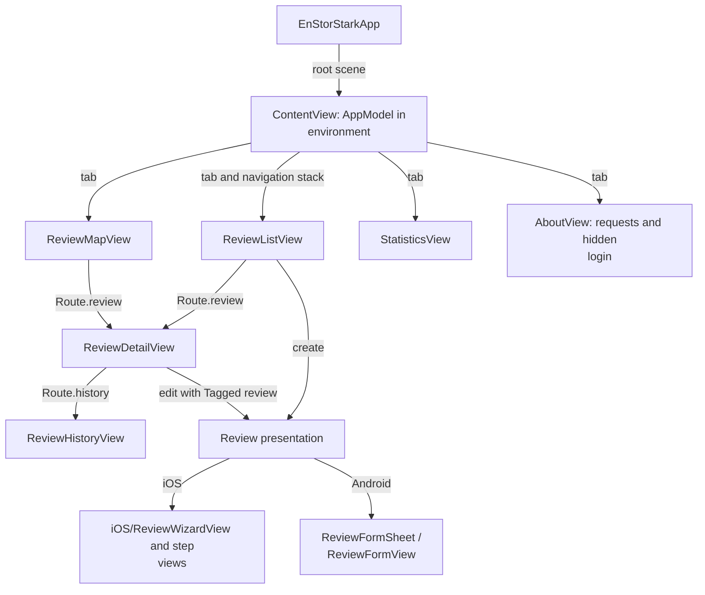
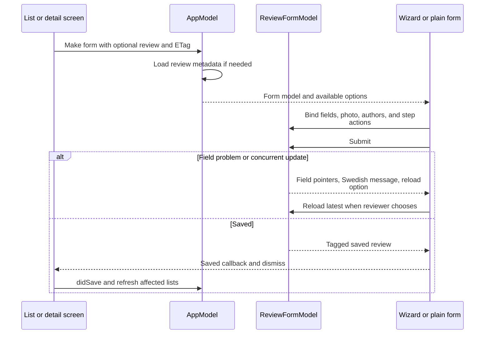

# Native screens and navigation

This module owns screen composition, navigation, platform presentation, photo selection, and form
interaction. It observes models from `EnStorStarkModel`; it does not implement backend access rules.

[Native app setup and architecture](../../README.md) · [Model and transport guide](../EnStorStarkModel/README.md) ·
[Verification guidance](../../AGENTS.md)

## Application composition

[ContentView.swift](ContentView.swift) owns tabs and route destinations, injects one `AppModel`,
and validates a restored session. Reviews, map, and statistics can navigate to review details.
[EnStorStarkApp.swift](EnStorStarkApp.swift) provides the root scene.

[iOS/](iOS/) contains the iOS screen design and wizard; [Android/](Android/) contains alternate
screen implementations selected with platform conditions. The screen types share names so common
navigation can use either implementation. Shared presentation helpers live in
[Components.swift](Components.swift); [ReviewImageProcessing.swift](ReviewImageProcessing.swift)
prepares picked photos before they become model input.

## Editing and feedback

The iOS wizard splits photo, bar/beer, ratings, text, and authors into steps. Android uses the plain
form in [ReviewFormView.swift](ReviewFormView.swift). Both submit through the same model. Screen
code owns dismissal, focus, discard confirmation, and placing server errors beside fields.
New-review local recovery and API conflict handling belong to the model, not a second UI workflow.

Use the [native verification guide](../../AGENTS.md) for simulator checks and the
[app README](../../README.md#running-ios) for build/debug routes. Check reader/reviewer navigation,
create/edit, field failures, stale edits, photo selection, and sign-out on supported native tooling.
