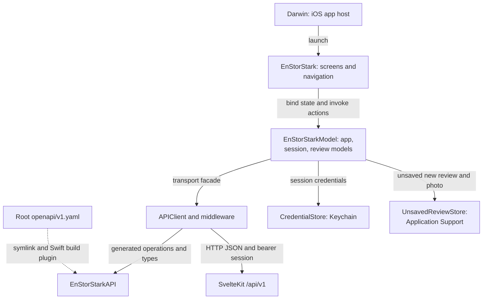

# En Stor Stark (iOS app)

Native iOS client for "En stor stark", in Swift and SwiftUI. It uses the JSON API in `/api/v1` of
this repository (see `../../docs/api.md` and `../../openapi/v1.yaml`). The Android app is a separate
native Kotlin app.

[Repository overview](../../README.md#architecture) · [API contract](../../openapi/README.md) ·
[Screen guide](Sources/EnStorStark/README.md) · [Model guide](Sources/EnStorStarkModel/README.md)

## Architecture



[Package.swift](Package.swift) defines the dependency direction: UI depends on models, and models
depend on the generated API module. The host project lives outside `Sources/`; the screen and model
guides explain the application code below that directory. The backend remains authoritative for
access and validation. The web client is primary, and native builds are best effort rather than a
prerequisite for backend work.

## Layout

- `Sources/EnStorStarkAPI` — client and types generated from the server contract. `openapi.yaml`
  is a symlink to `../../openapi/v1.yaml`; the `OpenAPIGenerator` build plugin regenerates the code on
  every build, so a contract change needs no extra step.
- `Sources/EnStorStarkModel` — `APIClient` (bearer token, problem+json errors) and app state.
- `Sources/EnStorStark` — SwiftUI screens. The design (dark, amber accent, Liquid Glass) lives in
  `iOS/`; `Components.swift` has shared helpers. iOS 26 or later (Liquid Glass).
- `Tests/EnStorStarkModelTests` — Swift Testing tests for the model module.
- `Darwin/` — Xcode project for the app host. `Darwin/EnStorStark.xcconfig` has the app name,
  bundle ID, and version. Releases set the build number (`../README.md#releases`).

## Running (iOS)

1. Start the server from the repository root: `make dev` (http://localhost:5173, login
   `test` / `testpass123`).
2. Open `Project.xcworkspace` in Xcode and run the "EnStorStark App" scheme on a simulator.

Or from the terminal:

```sh
xcodebuild -workspace Project.xcworkspace -scheme "EnStorStark App" \
  -destination 'platform=iOS Simulator,name=iPhone 17' -derivedDataPath .build/xcode \
  -skipPackagePluginValidation build
```

Coding agents use [XcodeBuildMCP](https://github.com/getsentry/XcodeBuildMCP) with
`../../.xcodebuildmcp/config.yaml` (workspace, scheme, and project simulator).
Create the project simulator once with the command in that file. From the repository root,
`xcodebuildmcp simulator build-and-run` builds and starts the app, and the `ui-automation`
commands read the UI. See `AGENTS.md` for how to verify the app.

Launch arguments help with checks in the simulator without taps:
`-selectedTab reviews|map|statistics|about`, and (Debug builds only)
`-debugRoute review:<slug>`, `-debugRoute history:<slug>`, `-debugSignIn user:password` (or
`-debugSignIn out`), `-debugCreate YES` (new-review form), and `-debugEdit YES` (with a review
route: edit form), and `-debugWizardStep photo|bar|beer|ratings|text|authors` (opens that wizard
step). For example:
`xcrun simctl launch booted se.enstorstarkreview.app -debugRoute review:norrmalms-källare`.

Only Debug builds allow plain HTTP to local hosts (`Darwin/Info-Debug.plist`).

## Tests

The model tests run on the project simulator (the screens need UIKit, so `swift test` on the Mac
cannot build the package):

```sh
xcodebuild test -workspace Project.xcworkspace -scheme EnStorStarkModelTests \
  -destination 'platform=iOS Simulator,name=En Stor Stark (iPhone 18 Pro)' \
  -derivedDataPath .build/xcode -skipPackagePluginValidation
```

The scheme is shared in `.swiftpm/xcode/xcshareddata/xcschemes`. The test bundle has no host app,
so it cannot use the Keychain; tests use `SecureStorage` doubles.

## Releases

`mise run release:ios` from `mobile/` runs the model tests, archives, and uploads to TestFlight
with `ExportOptions.plist`; see [the release guide](../README.md#releases).

## Servers

`AppConfiguration.serverOrigin` selects the server. Release builds always use production
(`https://enstorstarkreview.se`). Debug builds use the local `make dev` server by default
(`localhost:5173`).

To change the server in a Debug build, shake the device (simulator: Device › Shake, ⌃⌘Z), or
tap the "Server" row at the bottom of "Om". Choose local, production, or
enter any origin, for example an ngrok URL for a real phone. Start the tunnel with
`ngrok http 5173 --host-header=rewrite`: Vite rejects requests for unknown hosts with 403. The choice
is saved; a change signs out and reloads the app. The launch argument
`-debugServerOrigin <url>` overrides the saved choice.

## Reviewer mode

The login is hidden: long-press the "Version" row at the bottom of "Om". The token is stored in the
Keychain (`CredentialStore`), with the same item attributes that the Skip build used, so an update
keeps the session. A 401 on a request
that sent the token clears it and returns the app to reader mode. Sign-out also clears
`URLCache`, so no draft data stays on the device.

## Review form

The iOS price ruler follows the drag continuously and coasts after a flick, with exponential
friction before settling on a whole krona. A new touch stops the coast immediately; manual
price entry, VoiceOver adjustment, leaving the step, and backgrounding also cancel it.
Reduce Motion disables the coast. Prices stay within the API metadata's limits, and only
visible ruler ticks are drawn. The motion rules live in `EnStorStarkModel/PriceRulerMotion.swift`
and are covered by `PriceRulerMotionTests` in the model tests. In the simulator, open the beer
step, flick left and right, interrupt a moving ruler, and try both price limits. Also check
manual entry, VoiceOver adjustment, and Reduce Motion.

Reviewers create drafts with "+" in Recensioner and edit with "Redigera" on a review. This
opens a full-screen wizard (`Sources/EnStorStark/iOS/ReviewWizardView.swift`): photo and crop,
bar and attributes, price and brand, one card per rating aspect, overall rating and text, and
authors with a card preview. An edit starts on a list of all steps. A new review keeps a local copy
(`UnsavedReviewStore`) until it is saved or discarded; a sign-out removes it. The wizard
covers every field of the API and shows server errors next to the field that the problem pointer
names. Photos come from the system photo picker (`PhotosPicker`, no photo permission needed) or
the camera (`UIImagePickerController`); the app converts them to JPEG and scales them to at most
2560 px. Edits send the `ETag` as
`If-Match`; after a 412 or `concurrent_update` the form offers to load the latest version.

The generated client URI-encodes header parameters, so `ConditionalHeaderMiddleware` sends
`If-Match`/`If-None-Match` raw. Without it, every edit fails with 412.

The beer volume is optional (quick picks 33/40/50/60 cl, or typed). The contract keeps a stored
volume when `beer.volumeCl` is omitted and clears it on `null`, but the generated client omits nil
properties, so `ExplicitBeerVolumeMiddleware` adds `"volumeCl": null` to review writes without a
volume. The detail page shows the volume and cl/kr (not for happy hour prices).

Brand logos are bundled in `Module.xcassets/Brand` (PNG copies of the web's `static/beer-brands`);
`BeerBrandLogo` maps brand names to them. When the web adds a brand, add its logo here too:
`BeerBrandLogoTests` checks that every brand in `Fixtures/review-metadata.json` has one.

"Ta bort recensionen" sits at the bottom of the edit overview. The delete sends the `ETag` the
form was read with, so a review that changed in the meantime is not deleted: a 412 or 409 shows
"Recensionen har ändrats" and loads the new version. A 404 counts as deleted (someone else was
first). Afterwards the detail closes and the feed shows a toast.

The barhop rating shows reviewed bars near the address from `GET /nearby-reviews` (counts per
radius, the nearest bars in a sheet). The centre is the address's saved position on the server,
never the device location; an edit passes its slug as `exclude`. Swift OpenAPI Generator drops
`oneOf` schemas that mix `null` and a `$ref`, so nullable objects in the contract use an inline
`type: [object, 'null']`.

"Närmast" in the feed loads the newest reviews from the API and orders them on the device by
straight-line distance (the web's haversine, one-decimal kilometres): equal distances stay newest
first, and reviews without a map marker go last. Positions come from `GET /map`; the device
location is read once per selection, kept in memory, and never sent. Without location access the
feed shows the newest first and links to Settings.
