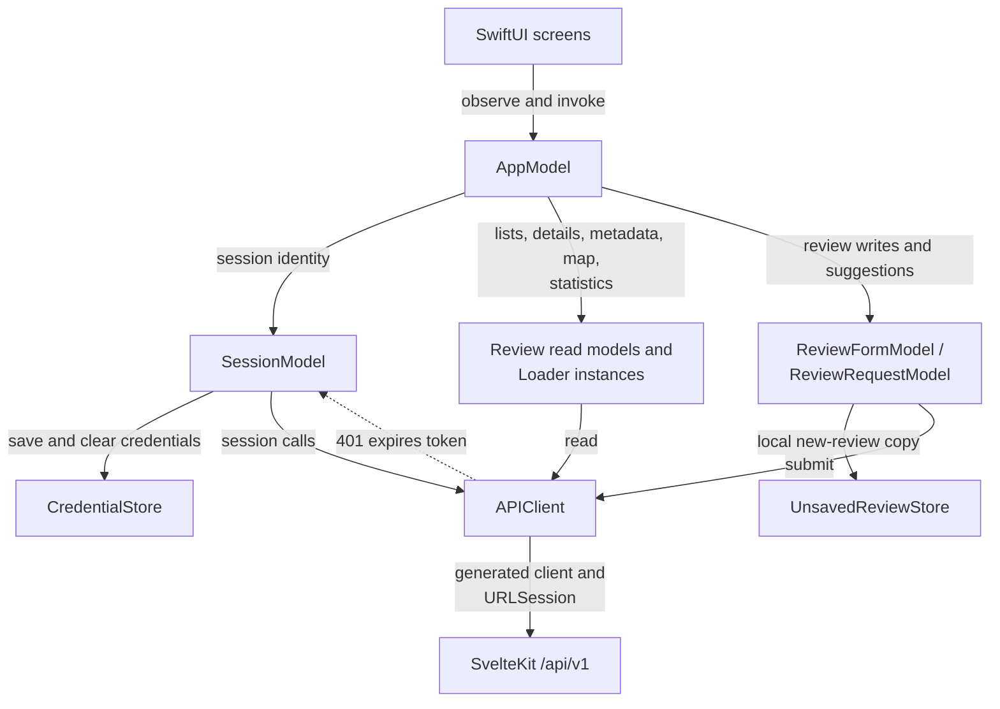
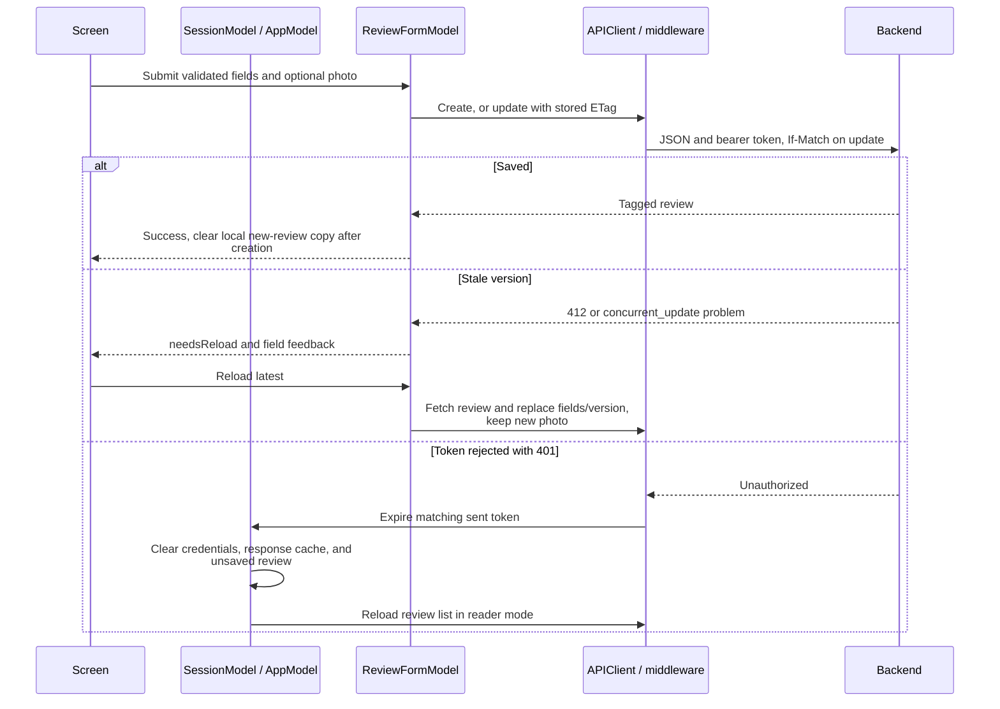

# Native state and API transport

This module owns observable app state, API calls, session credentials, loading/error state, and review form data.
Screens bind to these models; the generated API module supplies wire types and operations.
The server enforces authorization and persisted business rules.

[Native architecture](../../README.md#architecture) · [Screens](../EnStorStark/README.md) · [Backend API guide](../../../../src/lib/server/api/README.md)

## State and transport

[AppModel.swift](AppModel.swift) composes app-wide models and refreshes lists after saves/publication.
[ReviewListModel.swift](ReviewListModel.swift) owns list loading and query state; [ReviewRequestModel.swift](ReviewRequestModel.swift) owns bar-suggestion submission and feedback.
[Loader.swift](Loader.swift) provides reusable loading state; [ReviewDetailModel.swift](ReviewDetailModel.swift) retains the review's ETag for editing.
[API/APIClient.swift](API/APIClient.swift) wraps generated operations, maps responses, and resolves image URLs against the selected server.
[API/APIMiddleware.swift](API/APIMiddleware.swift) adds bearer tokens, converts problem responses into errors, and preserves raw conditional headers.

## Saving and leaving reviewer mode

[ReviewFormModel.swift](ReviewFormModel.swift) owns client validation, JSON field construction, server problem pointers, and conflict recovery.
[UnsavedReviewStore.swift](UnsavedReviewStore.swift) stores one new-review copy and photo in Application Support, scoped to the current username; it is separate from a draft already saved on the server.
[CredentialStore.swift](CredentialStore.swift) uses platform secure storage for the session token.

[SessionModel.swift](SessionModel.swift) restores credentials, validates sessions, and clears local identity on token rejection.
A network failure during session validation keeps reviewer mode.
Explicit sign-out attempts server revocation but still clears local state if that call fails.
Session changes clear URL response caching, remove unsaved content when signed out, and reload the review list.
A debug server switch signs out and creates a new `AppModel`.

See [backend API regressions](../../../../tests/api.test.ts) for protocol guarantees and the [native verification guide](../../AGENTS.md) for device/simulator checks.
Backend tests do not substitute for checking native UI and local storage behavior.
