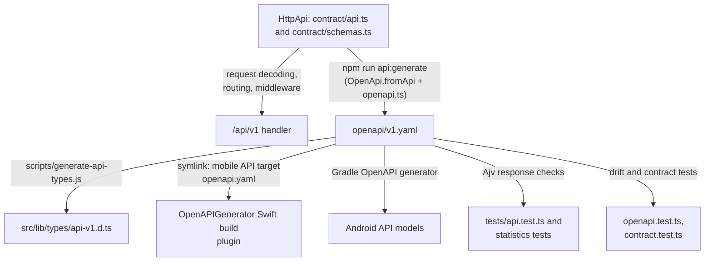

# Native API contract

[v1.yaml](v1.yaml) documents the `/api/v1` endpoints, schemas, problem codes, and JSON body
budgets. It is **generated** from the Effect `HttpApi` in
[src/lib/server/api/contract](../src/lib/server/api/contract/); do not edit it by hand.

[Repository overview](../README.md#architecture) · [API adapters](../src/lib/server/api/README.md) ·
[API decisions](../docs/api.md) · [iOS app](../mobile/ios/README.md) · [Android app](../mobile/android/README.md)

## One definition, several consumers

`npm run api:generate` renders the YAML and the TypeScript types; `npm run api:types` only
regenerates the types from the YAML, and `npm run api:lint` lints it with Redocly. The unit test
[openapi.test.ts](../src/lib/server/api/openapi.test.ts) fails when the checked-in YAML differs
from the `HttpApi`, so a contract change cannot ship without its YAML diff.

[openapi.ts](../src/lib/server/api/openapi.ts) post-processes the generator output so generated
clients keep compiling: it keeps component names and `allOf` compositions, closes request schemas
but leaves response schemas open, makes paths relative to the `/api/v1` server, and adds response
descriptions and headers from each endpoint's `Responses` annotation. The Swift API target uses a
[symlink](../mobile/ios/Sources/EnStorStarkAPI/openapi.yaml) and
[generator configuration](../mobile/ios/Sources/EnStorStarkAPI/openapi-generator-config.yaml) to
generate its client at build time.

## Endpoint families

| Capability                                                   | Routes below `/api/v1`                                                                  |
| ------------------------------------------------------------ | --------------------------------------------------------------------------------------- |
| Session creation, inspection, revocation                     | `/sessions`, `/sessions/current`                                                        |
| Review list/create, detail/edit/delete, publication, history | `/reviews`, `/reviews/{slug}`, `/reviews/{slug}/publication`, `/reviews/{slug}/history` |
| Form options, author choices, nearby comparison              | `/review-metadata`, `/users`, `/nearby-reviews`                                         |
| Images, public map, admitted geocoding                       | `/images/{filename}`, `/map`, `/map/geocoding`                                          |
| Statistics and bar suggestions                               | `/statistics`, `/review-requests`                                                       |

The API reuses web workflows and collaborative access rules. Public reads hide drafts and unknown
publication states; authenticated reads can include active drafts. Deleted reviews stay hidden.
Body-bearing endpoints accept JSON, including base64 photos for review writes. Each request schema's
`x-max-body-bytes` bounds actual streamed input before parsing. Strong `If-Match` is required for
edits and deletion.

When changing exposed behavior, change the `HttpApi` first, then request/response/metadata mappings
and regressions together, and follow the [API workflow](../docs/api.md#contract-and-tdd-workflow).
