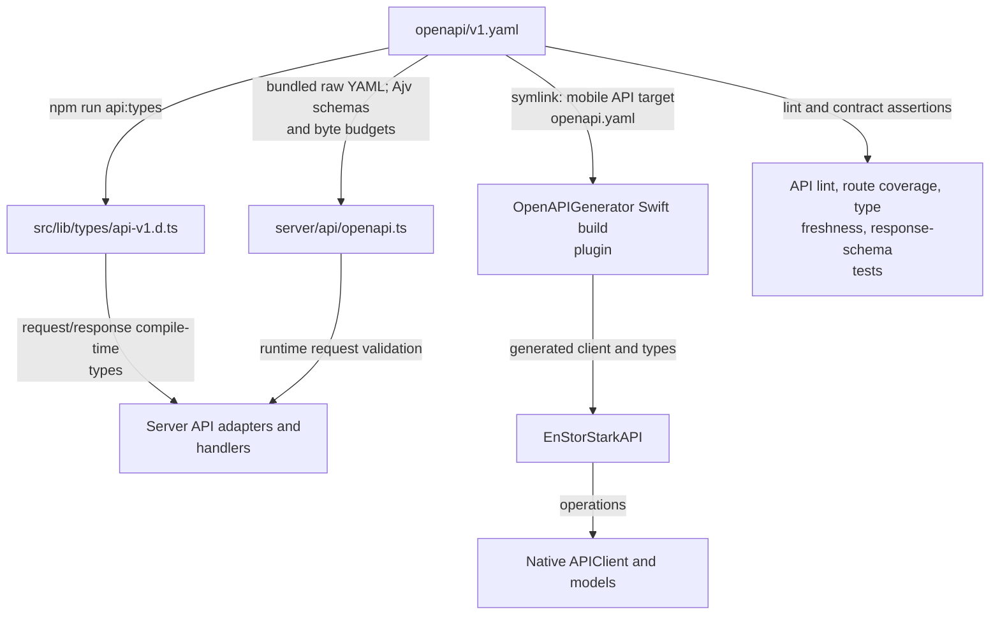

# Native API contract

[v1.yaml](v1.yaml) is the source of truth for `/api/v1` endpoints, schemas, problem codes, and JSON
body budgets. Both server validation and native client generation consume this contract.

[Repository overview](../README.md#architecture) · [API adapters](../src/lib/server/api/README.md) ·
[API decisions](../docs/api.md) · [Native app](../mobile/README.md)

## One contract, three consumers

[generate-api-types.js](../scripts/generate-api-types.js) writes the checked-in TypeScript types.
Never edit that output manually. The Swift API target uses a
[symlink](../mobile/Sources/EnStorStarkAPI/openapi.yaml) and
[generator configuration](../mobile/Sources/EnStorStarkAPI/openapi-generator-config.yaml) to generate
its client at build time; generated Swift output is not a separate hand-maintained contract.

## Endpoint families

| Capability                                            | Routes below `/api/v1`                                                                  |
| ----------------------------------------------------- | --------------------------------------------------------------------------------------- |
| Session creation, inspection, revocation              | `/sessions`, `/sessions/current`                                                        |
| Review list/create, detail/edit, publication, history | `/reviews`, `/reviews/{slug}`, `/reviews/{slug}/publication`, `/reviews/{slug}/history` |
| Form options and author choices                       | `/review-metadata`, `/users`                                                            |
| Images, public map, admitted geocoding                | `/images/{filename}`, `/map`, `/map/geocoding`                                          |
| Statistics and bar suggestions                        | `/statistics`, `/review-requests`                                                       |

The API reuses web workflows and collaborative access rules. Public reads hide drafts and unknown
publication states; authenticated reads can include active drafts. Deleted reviews stay hidden.
Body-bearing endpoints accept JSON, including base64 photos for review writes. Each request schema's
`x-max-body-bytes` bounds actual streamed input before parsing. Strong `If-Match` is required for edits.

When changing exposed behavior, update the contract first, then request/response/metadata mappings
and regressions together. Run `npm run api:types` and `npm run api:lint`; follow the
[API workflow](../docs/api.md#contract-and-tdd-workflow) for required application checks.
[Contract tests](../src/lib/server/api/contract.test.ts) check routes and type freshness;
[integration tests](../tests/api.test.ts) check HTTP behavior and representative response schemas.
