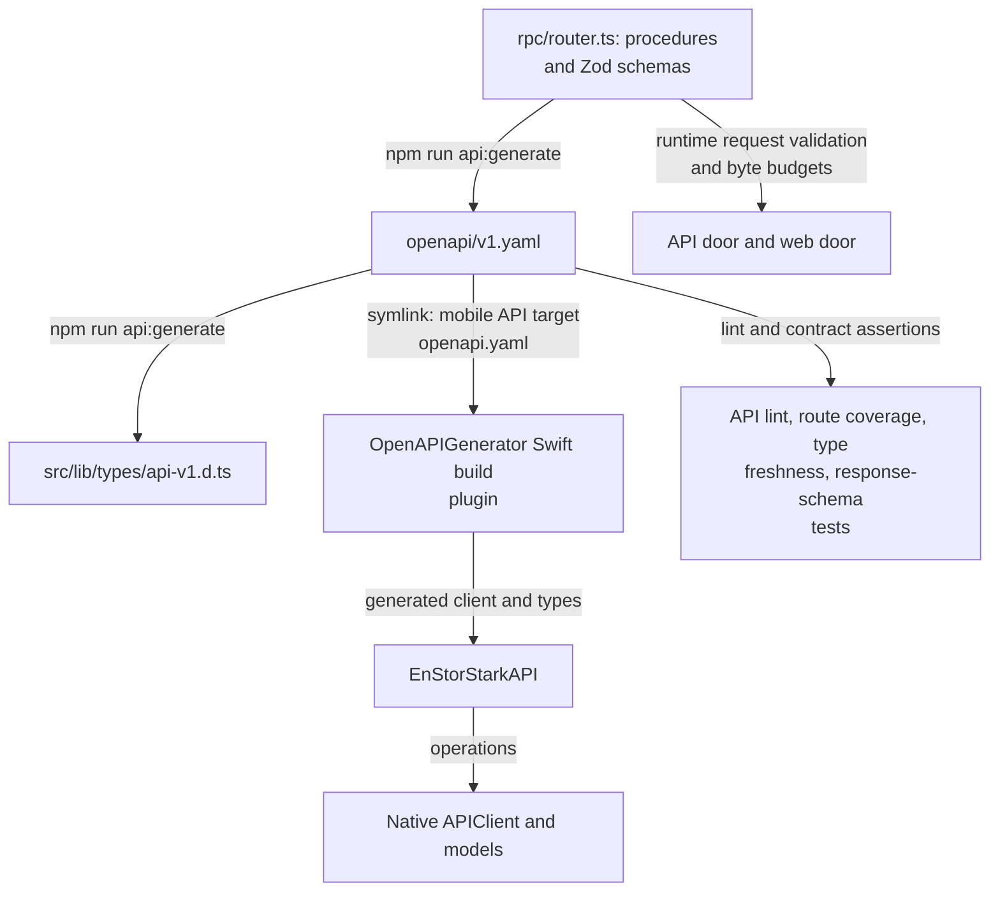

# Native API contract

[v1.yaml](v1.yaml) is the `/api/v1` contract: endpoints, schemas, problem codes, and JSON body
budgets. It is **generated** from the oRPC router in [src/lib/server/rpc](../src/lib/server/rpc/README.md)
by `npm run api:generate`; never edit it by hand. The same Zod schemas validate requests at runtime,
and the native clients generate from the file.

[Repository overview](../README.md#architecture) · [Server features](../src/lib/server/rpc/README.md) ·
[API decisions](../docs/api.md) · [iOS app](../mobile/ios/README.md) · [Android app](../mobile/android/README.md)

## One contract, three consumers

[generate-openapi.js](../scripts/generate-openapi.js) writes the YAML and then, with
[generate-api-types.js](../scripts/generate-api-types.js), the checked-in TypeScript types.
Never edit either output manually. `npm run api:diff` compares the contract semantically with
`origin/main` ([compare-openapi.js](../scripts/compare-openapi.js)): shared definitions are inlined
and descriptions only counted, so the output lists changes that clients can notice. The Swift API target uses a
[symlink](../mobile/ios/Sources/EnStorStarkAPI/openapi.yaml) and
[generator configuration](../mobile/ios/Sources/EnStorStarkAPI/openapi-generator-config.yaml) to generate
its client at build time; generated Swift output is not a separate hand-maintained contract.

## Endpoint families

| Capability                                                   | Routes below `/api/v1`                                                                  |
| ------------------------------------------------------------ | --------------------------------------------------------------------------------------- |
| Session creation, inspection, revocation                     | `/sessions`, `/sessions/current`                                                        |
| Review list/create, detail/edit/delete, publication, history | `/reviews`, `/reviews/{slug}`, `/reviews/{slug}/publication`, `/reviews/{slug}/history` |
| Form options, author choices, nearby comparison              | `/review-metadata`, `/users`, `/nearby-reviews`                                         |
| Images, public map, admitted geocoding                       | `/images/{filename}`, `/map`, `/map/geocoding`                                          |
| Statistics and bar suggestions                               | `/statistics`, `/review-requests`                                                       |

The API reuses web workflows and collaborative access rules. Public reads hide drafts and unknown
publication states; authenticated reads can include active drafts. Deleted reviews stay hidden.
Body-bearing endpoints accept JSON, including base64 photos for review writes. Each request schema's
`x-max-body-bytes` bounds actual streamed input before parsing. Strong `If-Match` is required for edits and deletion.

When changing exposed behavior, change the procedure and its schemas, the representation mappings
and regressions together. Run `npm run api:generate`, `npm run api:diff` and `npm run api:lint`;
follow the [API workflow](../docs/api.md#contract-and-tdd-workflow) for required application checks.
[Contract tests](../src/lib/server/rpc/openapi.test.ts) check that the YAML and types are fresh and
that every procedure is documented;
[integration tests](../tests/api.test.ts) check HTTP behavior and representative response schemas.
