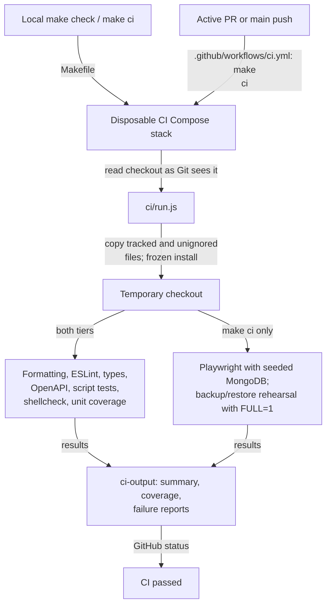
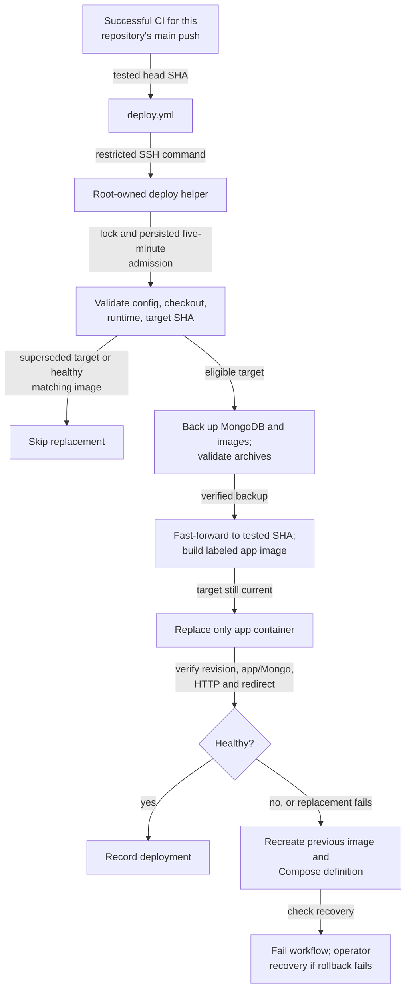

# Utilities, CI, and deployment

This directory owns command-line utilities and automation. Application rules remain in `src/`;
scripts invoke shared policy where needed and provide reproducible verification/deployment entrypoints.

[Repository overview](../README.md#architecture) · [Test guide](../tests/README.md) ·
[Deployment runbook](../docs/deployment.md) · [Dependency policy](../docs/dependency-security.md)

## Local and GitHub checks

[ci/run.js](ci/run.js) selects the `check` or `ci` tier, runs the checks between its required
setup steps side by side, and writes reports. The root
[Makefile](../Makefile) creates an isolated stack per checkout and removes disposable services.
[The CI workflow](../.github/workflows/ci.yml) runs the same command for active PRs and main
pushes, one check group per runner, and **CI passed** requires them all; draft PRs skip it. The coverage floor lives in [vite.config.ts](../vite.config.ts).

## Backup-first deployment

[deploy/ssh-command.sh](deploy/ssh-command.sh) restricts SSH input; [deploy/deploy.py](deploy/deploy.py)
owns validation, admission, backups, deployment, and rollback. Only temporary lock/cooldown rejection
is automatically retried, always with the tested SHA. Failed backup/build stops before replacement.
A newer main revision detected during backup/build skips the superseded run. Code rollback preserves
newer database/image writes; restoring those backups is an operator action. Changing the local helper
does not install it on the VPS. Detailed configuration, recovery, and retention stay in the runbook.

## Other utilities and checks

| Script or test                                                                                                                     | Responsibility                                                                                     |
| ---------------------------------------------------------------------------------------------------------------------------------- | -------------------------------------------------------------------------------------------------- |
| [create-user.js](create-user.js)                                                                                                   | Create pre-provisioned accounts with shared password policy                                        |
| [seed-bars.js](seed-bars.js)                                                                                                       | Development-only demo reviews/images, including legacy and draft cases                             |
| [generate-api-types.js](generate-api-types.js)                                                                                     | Generate TypeScript declarations from the OpenAPI contract                                         |
| [ci/run.test.js](ci/run.test.js), [ci/workflows.test.js](ci/workflows.test.js)                                                     | Runner, report, workflow, and deployment-trigger regressions                                       |
| [ci/mobile-workflow.test.js](ci/mobile-workflow.test.js), [ci/mobile-release-workflow.test.js](ci/mobile-release-workflow.test.js) | Mobile check and release triggers, change gating, token and secret scope, pinned actions and Xcode |
| [deploy/test_deploy.py](deploy/test_deploy.py)                                                                                     | Deployment orchestration with substituted operations                                               |
| [deploy/test_backup_restore.py](deploy/test_backup_restore.py)                                                                     | Disposable Docker backup/restore rehearsal                                                         |

`npm run test:ci` runs script/workflow regressions. `npm run test:deploy:restore` runs the Docker
rehearsal; `make ci FULL=1` includes both, and plain `make ci` skips the rehearsal. Never use production data or real notification delivery as test
fixtures. See [automation guidance](../docs/agents/dependencies-and-deployment.md) before changing scripts.
