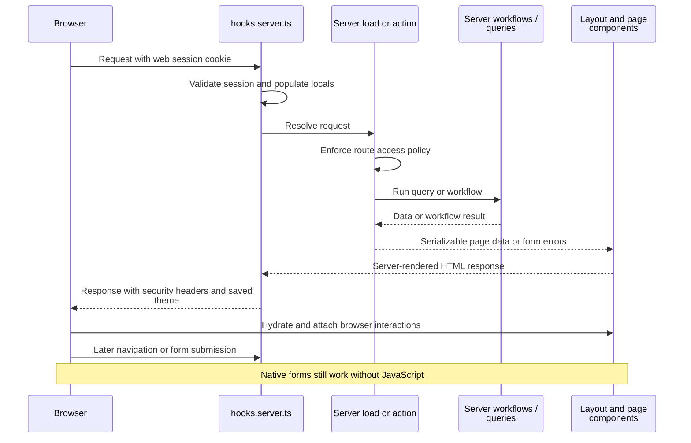
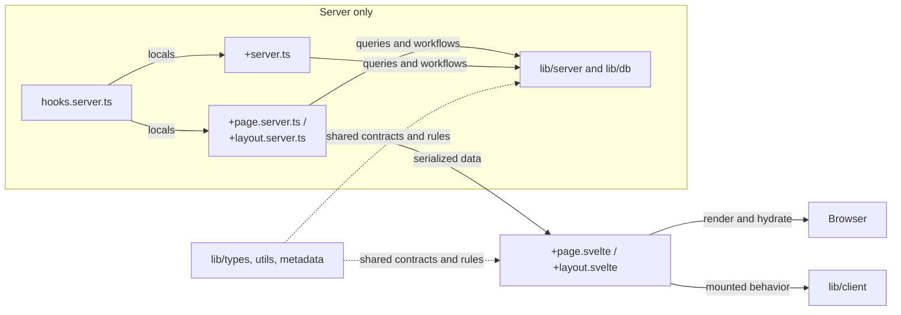

# Application source

This directory contains the SvelteKit application: request hooks, routes, shared library code, the HTML shell, and global styles.
Start here to follow a request from the server to the browser.

[Repository overview](../README.md#architecture) · [Routes](routes/README.md) · [Library boundaries](lib/README.md) · [Detailed architecture](../docs/architecture.md)

## From request to page

[hooks.server.ts](hooks.server.ts) starts the shared Mongo connection once and validates sessions.
Web routes use cookies; `/api/*` uses bearer tokens only.
Hooks supply `locals.user` and `locals.session`, but each route still decides whether the operation is authorized.
[The root layout load](routes/+layout.server.ts) supplies safe user data and visitor preferences.

## Where code runs

Server files own credentials and protected I/O.
Svelte components render on the server and then run interactively in the browser; browser APIs belong in mounted handlers/helpers.
`+page.ts`, where present, is a universal load module rather than a server-only boundary.

Read [app.html](app.html) for the initial document and preference placeholders, [app.css](app.css) for shared styling, and [app.d.ts](app.d.ts) for request-local types.
The CSP is configured outside this directory in [svelte.config.js](../svelte.config.js).

Representative checks: [layout data tests](routes/layout.server.test.ts), [review action tests](routes/review-actions.test.ts), and [browser session tests](../tests/session-cookies.test.ts).
