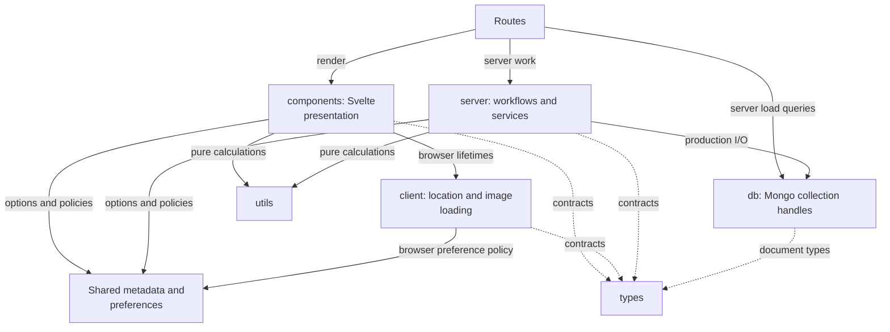

# Shared library and boundaries

This directory holds reusable application code. Choose a module by its responsibility and
execution environment: shared data/rules, presentation, browser resources, server work, or storage.

[Application source](../README.md) · [Components](components/README.md) ·
[Server](server/README.md) · [Database](db/README.md)

## Dependency direction

Arrows below mean imports or calls, rather than HTTP requests.

Components and browser helpers never import server modules or database handles. Shared types live
in [types/](types/); pure calculations and formatting live in [utils/](utils/). These folders are
explained here rather than receiving a README for each small module.

## Shared rule owners

| Area                                        | Start here                                                                             |
| ------------------------------------------- | -------------------------------------------------------------------------------------- |
| Rating labels, keys, weights, overall score | [review-metadata.ts](review-metadata.ts), [ratings.ts](utils/ratings.ts)               |
| Beer options, activities, and amenities     | [beer-brands.ts](beer-brands.ts), [bar-attributes.ts](bar-attributes.ts)               |
| Price, serving size, value, and comparisons | [beer-value.ts](utils/beer-value.ts), [price-comparison.ts](utils/price-comparison.ts) |
| Form/wizard input and error steps           | [review-form.ts](utils/review-form.ts), [review-wizard.ts](review-wizard.ts)           |
| Safe review Markdown                        | [review-markdown.ts](utils/review-markdown.ts)                                         |
| Browser location and analytics choices      | [preferences.ts](preferences.ts), [browser helpers](client/README.md)                  |
| Theme cookies and browser notifications     | [theme.ts](theme.ts)                                                                   |
| Native API types                            | [api-v1.d.ts](types/api-v1.d.ts), generated from [OpenAPI](../../openapi/README.md)    |

Preferences and theme parsing are usable during server rendering; their browser-writing functions
persist cookies and notify mounted consumers. Never place mutable visitor state in shared server
module variables. Visitor coordinates stay in browser memory.

Tests live beside their owners, for example [rating tests](utils/ratings.test.ts),
[publication helper tests](utils/publication.test.ts), and [preference tests](preferences.test.ts).
The [architecture index](../../docs/architecture.md#rule-to-test-index) maps broader rules to tests.
