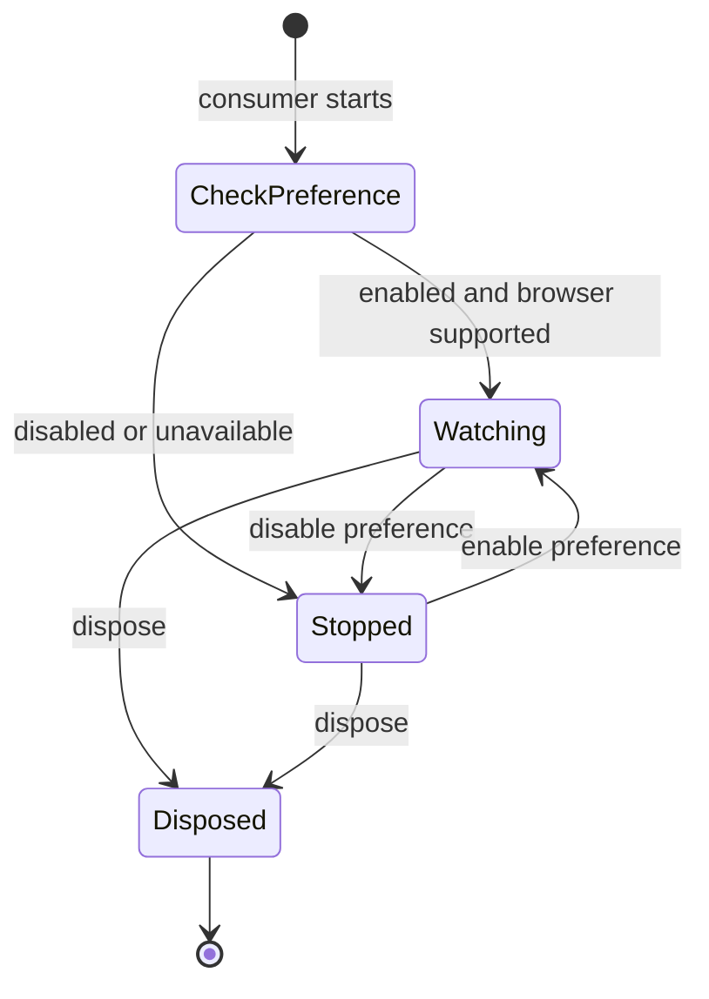
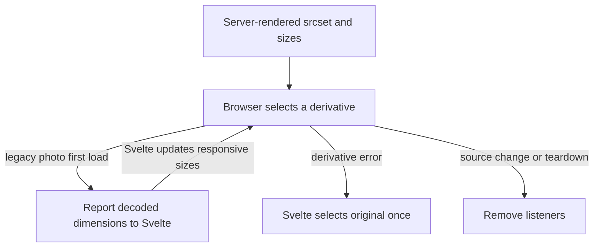

# Browser resource lifecycles

This directory owns browser-only location tracking and responsive image loading.
Consumers start work when mounted and dispose it on navigation, source changes, or component teardown.

[Library boundaries](../README.md) · [Components](../components/README.md) · [Map policy](../../../docs/agents/map.md)

## Location watching

[user-location.ts](user-location.ts) checks the location preference before calling `watchPosition`, validates results, produces Swedish feedback, and ignores callbacks from invalidated watches.
Valid fixes update consumer memory; errors clear the position and report feedback.
Disabling the preference clears the watcher and position; re-enabling restarts supported consumers.
Home/detail/map consumers watch while mounted.
Review-form guidance requests a position explicitly and stops after its first result.
Browser permission and the site's saved preference are separate.
Coordinates stay in memory; [preferences.ts](../preferences.ts) stores only the user's choice.

## Responsive images

[review-image-loading.ts](review-image-loading.ts) reports first decoded dimensions or failure and owns listener cleanup.
It never writes image attributes or observes layout sizes.
The [server image flow](../server/README.md#image-reads) owns authorization and derivative generation.
[ReviewImage](../components/ReviewImage.svelte) owns all source attributes and fallback state, using its caller's layout sizes and trusted upload dimensions when available.
Legacy decoded dimensions remain tied to their source and are reported once to prevent feedback from density rounding.

The adjacent [location tests](user-location.test.ts) and [image-loading tests](review-image-loading.test.ts) cover preferences, failures, stale callbacks, responsive sizing, and disposal.
Browser behavior is also covered by [distance tests](../../../tests/review-distance.test.ts) and [progressive image tests](../../../tests/progressive-images.test.ts).
