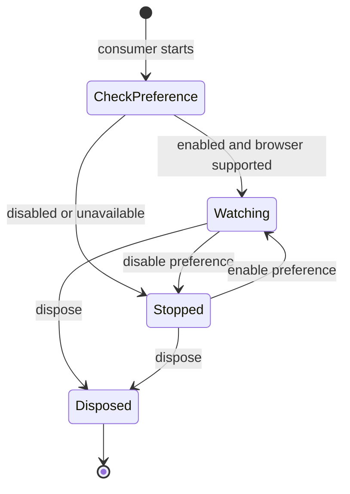
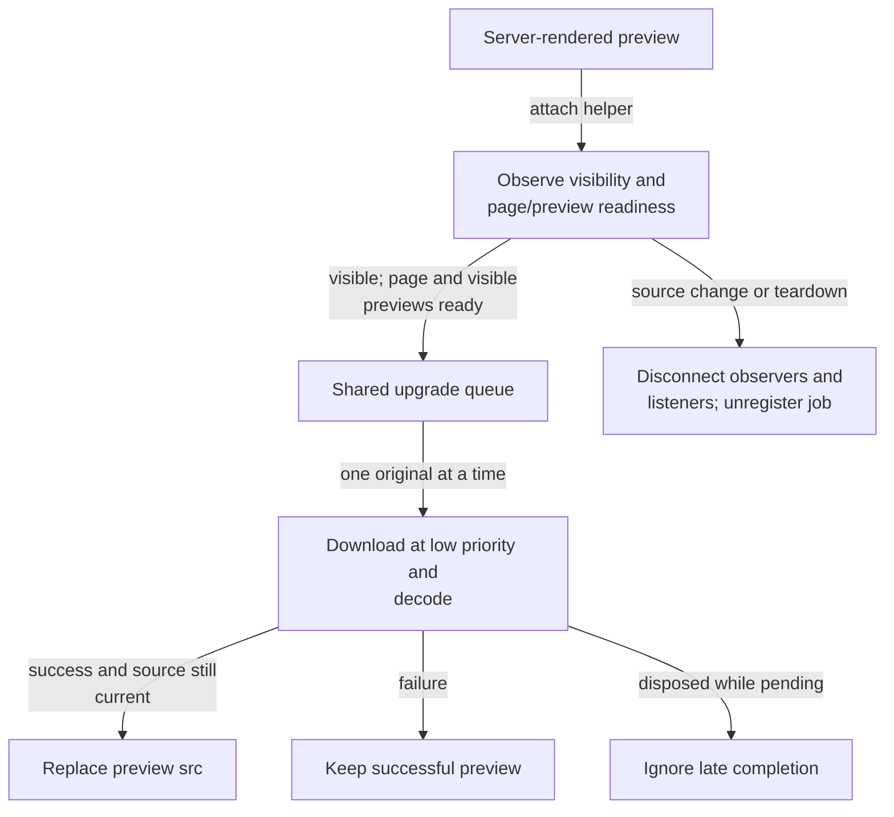

# Browser resource lifecycles

This directory owns browser-only location tracking and progressive image loading.
Consumers start work when mounted and dispose it on navigation, source changes, or component teardown.

[Library boundaries](../README.md) · [Components](../components/README.md) · [Map policy](../../../docs/agents/map.md)

## Location watching

[user-location.ts](user-location.ts) checks the location preference before calling `watchPosition`, validates results, produces Swedish feedback, and ignores callbacks from invalidated watches.
Valid fixes update consumer memory; errors clear the position and report feedback.
Disabling the preference clears the watcher and position; re-enabling restarts supported consumers.
Home/detail/map consumers watch while mounted.
Review-form guidance requests a position explicitly and stops after its first result.
Browser permission and the site's saved preference are separate.
Coordinates stay in memory; [preferences.ts](../preferences.ts) stores only the user's choice.

## Preview-to-original images

[review-image-loading.ts](review-image-loading.ts) owns scheduling and browser cleanup, not image authorization or server derivatives.
The [server image flow](../server/README.md#image-reads) handles those.
[ReviewImage](../components/ReviewImage.svelte) owns the component's source lifecycle.

The adjacent [location tests](user-location.test.ts) and [image-loading tests](review-image-loading.test.ts) cover preferences, failures, stale callbacks, scheduling, and disposal.
Browser behavior is also covered by [distance tests](../../../tests/review-distance.test.ts) and [progressive image tests](../../../tests/progressive-images.test.ts).
