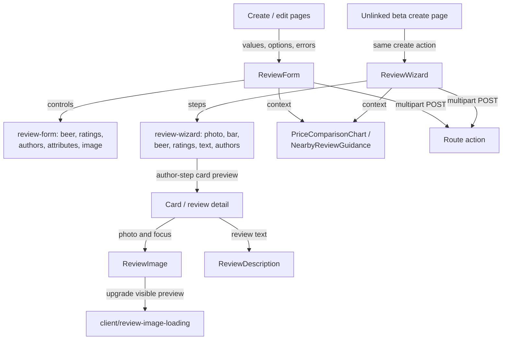
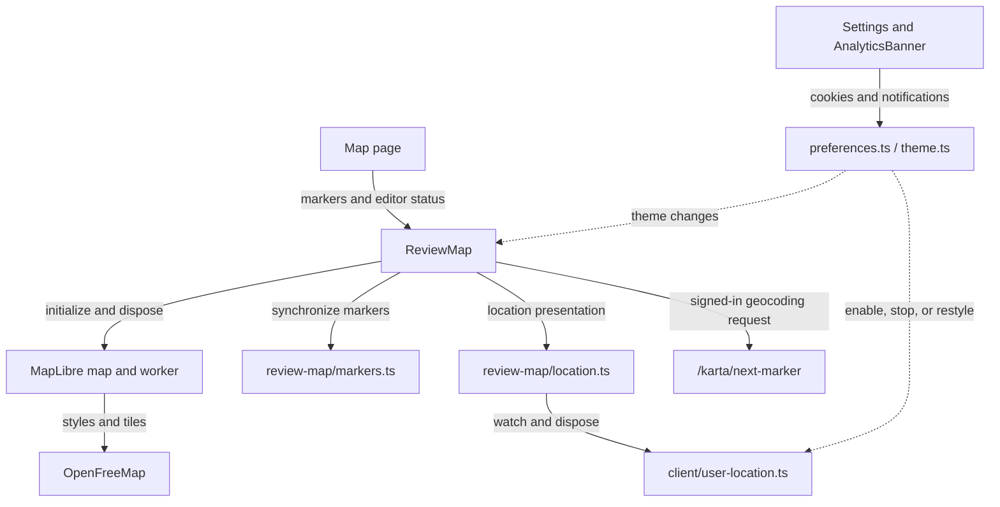

# Browser-facing components

This directory owns reusable Svelte presentation and interaction. Pages supply serialized data and
form results; components use shared types/utilities and browser helpers, while routes own saving.

[Library boundaries](../README.md) · [Browser helpers](../client/README.md) ·
[Design guidance](../../../DESIGN.md) · [Review workflows](../server/reviews/README.md)

## Review entry and display

[ReviewForm.svelte](ReviewForm.svelte) composes [review-form/](review-form/) controls and manages
submission state/error focus. The image picker owns its temporary object URLs and revokes them
on replacement or teardown. [ReviewWizard.svelte](ReviewWizard.svelte) uses
[review-wizard/](review-wizard/) steps and [shared step rules](../review-wizard.ts); hidden steps
remain in the form, and all steps appear without scripts. The component supports edit mode, but
no web route currently uses that mode.

[RatingGlass.svelte](RatingGlass.svelte) shares the logo mug across cards, review detail and the
wizard's overall-rating control. Its `rating` selects one of four aligned transparent PNGs in
`static/rating-glass/`; `class` sets its size and `decorative` suppresses its accessible label
when the containing badge or button already names the rating. Only positive ratings render a
mug; zero retains a screen-reader description without an image. Individual overall scores are
icon-only across cards, detail, map, history and editors. The wizard's native button cycles
0 → 1 → 2 → 3 → 0, announces the current score and names the next action; its zero choice reads
"Ingen stämpel". Returning to the suggested value restores the existing aspect-derived rating
behavior. The regular form keeps its native slider, accessible value and suggestion button,
without numeric tick labels. Statistics describes the unchanged average as stämplar per bar.

[Card.svelte](Card.svelte) puts every detail on one square photo and is also the wizard preview.
It preserves photo focus and loading priorities, limits titles to two lines and street/beer names
to one, and shows at most two activity tags plus a `+N` summary. `BarAttributePills` accepts an
opt-in `photo` variant and `maxVisible`; hidden labels remain accessible and the full list stays
on detail pages. `ReviewDescription` keeps its Markdown renderer and supports a `photo` tone for
two-line previews (one below a 320px card width), without changing ordinary full/preview styling.

The artwork was edited with the built-in imagegen tool from `static/logo.png`. The shared prompt
was to preserve the original mug, left handle, black contour, white keyline and illustrated style;
remove all lettering, ribbon and background; reconstruct the obscured base; keep the same framing
and actual alpha transparency. The four state prompts were: overflowing golden lager with cream
foam (3), entirely empty clear glass with no beer or foam (0), then the empty glass filled to
one-third (1) and three-quarters (2), with a thin internal head and no overflow. The empty version
was derived from the overflowing master; both intermediate versions used those two references.
The delivered PNGs share a 384 × 384 canvas and preserve room for the foam at every score.

[ReviewImage.svelte](ReviewImage.svelte) starts with server-provided previews for stored photos.
The browser helper replaces a preview only after the original decodes. Preview loading still works
without JavaScript. Forms submit to SvelteKit actions, not `/api/v1`.

## Map and visitor preferences

[ReviewMap.svelte](ReviewMap.svelte) owns map initialization, worker setup, selection, and teardown.
[review-map/](review-map/) owns marker synchronization and location presentation. Location helpers
clear resources on teardown and preference changes; coordinates never go to the application server.
The [map guide](../../../docs/agents/map.md) owns camera and geocoding policy.

Other components cover navigation, publication badges, attributes/search, statistics, and consent.
For behavior verification, see [wizard integration tests](../../../tests/review-wizard.test.ts),
[map tests](../../../tests/review-map.test.ts), and
[progressive image tests](../../../tests/progressive-images.test.ts).
