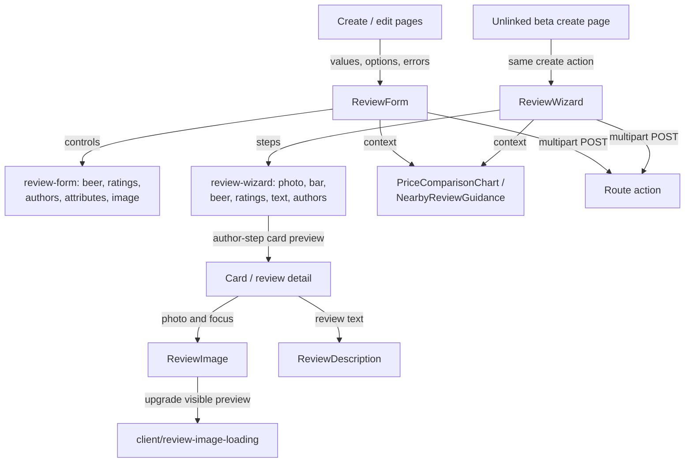
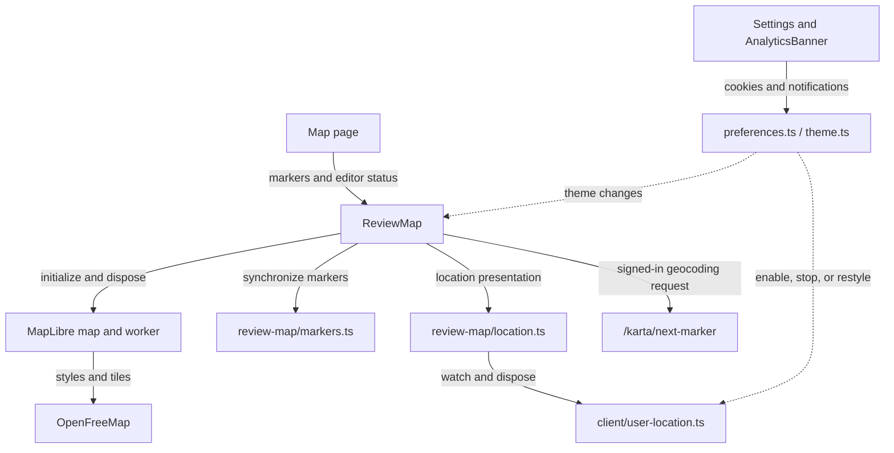

# Browser-facing components

This directory owns reusable Svelte presentation and interaction. Pages supply serialized data and
form results; components use shared types/utilities and browser helpers, while routes own saving.

[Library boundaries](../README.md) · [Browser helpers](../client/README.md) ·
[Design guidance](../../../DESIGN.md) · [Review workflows](../server/reviews/README.md)

## Review entry and display

[ReviewForm.svelte](ReviewForm.svelte) composes [review-form/](review-form/) controls and manages
submission state/error focus. The image picker owns its temporary object URLs and revokes them
on replacement or teardown. [ReviewWizard.svelte](ReviewWizard.svelte) uses
[review-wizard/](review-wizard/) steps and [shared step rules](../review-wizard.ts); hidden steps
remain in the form, and all steps appear without scripts. The component supports edit mode, but
no web route currently uses that mode.

[ReviewImage.svelte](ReviewImage.svelte) starts with server-provided previews for stored photos.
The browser helper replaces a preview only after the original decodes. Preview loading still works
without JavaScript. Forms submit to SvelteKit actions, not `/api/v1`.

## Map and visitor preferences

[ReviewMap.svelte](ReviewMap.svelte) owns map initialization, worker setup, selection, and teardown.
[review-map/](review-map/) owns marker synchronization and location presentation. Location helpers
clear resources on teardown and preference changes; coordinates never go to the application server.
The [map guide](../../../docs/agents/map.md) owns camera and geocoding policy.

Other components cover navigation, publication badges, attributes/search, statistics, and consent.
For behavior verification, see [wizard integration tests](../../../tests/review-wizard.test.ts),
[map tests](../../../tests/review-map.test.ts), and
[progressive image tests](../../../tests/progressive-images.test.ts).
