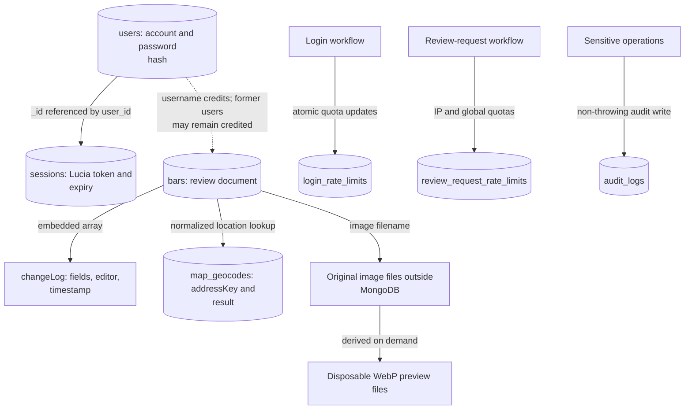
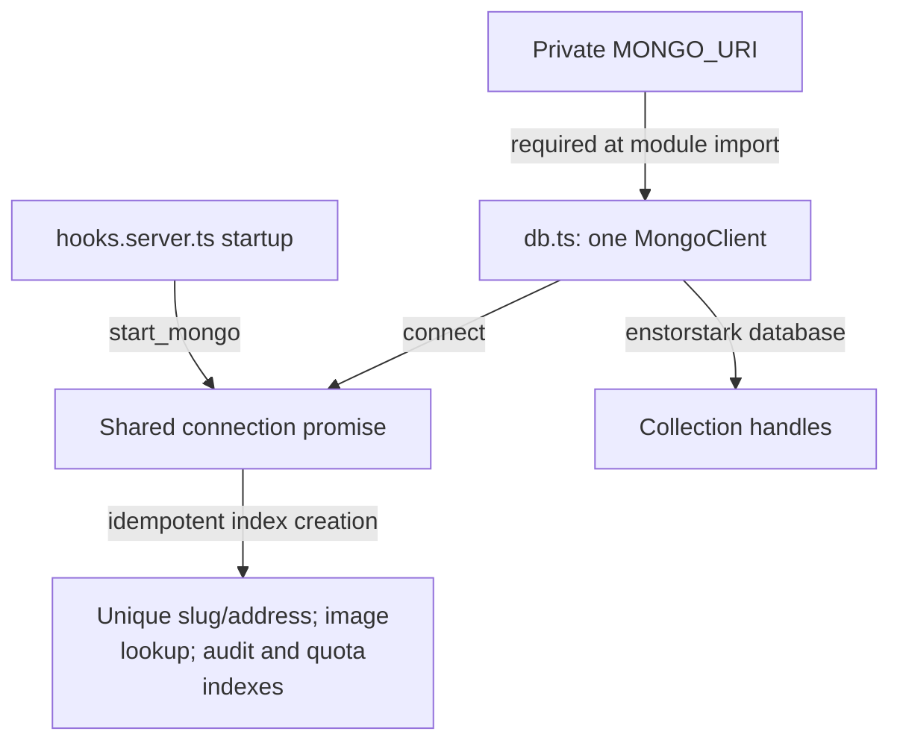

# MongoDB access and stored relationships

This directory owns the Mongo client and typed collection handles. Server loads, production
workflow dependencies, and focused server helpers use them; browser code never imports them.

[Library boundaries](../README.md) · [Server workflows](../server/README.md) ·
[Database container and seeding](../../../db/README.md)

## Stored data

The arrows describe application references and lookups, not enforced foreign keys.

[bars.ts](bars.ts), [users.ts](users.ts), and [map-geocodes.ts](map-geocodes.ts) expose typed
collections; they are thin handles, not repositories that enforce every rule. Session storage
is composed by [auth.ts](../server/auth.ts). Audit and rate-limit helpers access their own collections.
[Review types](../types/bar-review.ts) describe embedded history, credits, publication, and deletion.

Reviews reference authors by username, so deleting an account does not erase historic credit.
Geocodes are matched by normalized address rather than review ID. A review stores a photo filename,
not its bytes; image serving checks a visible referencing review before file access.

## Startup and lifetime

[db.ts](db.ts) requires `MONGO_URI` even during imports in build tools. The application selects the
`enstorstark` database explicitly. Startup creates the unique review slug and geocode address indexes,
the non-unique image lookup, audit lookup/90-day TTL, login-limit 30-day TTL, and review-request-limit
48-hour TTL. Initial demo accounts and baseline indexes come from the separate database image's
[init.js](../../../db/init.js) on a fresh volume.

Missing publication status means legacy public content; unknown statuses are excluded from public
reads. `deletedAt` hides a review without removing its document, history, or image. See
[publication rules and tests](../server/review-publication.test.ts),
[deletion tests](../server/review-deletion.test.ts), and
[database-backed integration fixtures](../../../tests/fixtures/reviews.ts).
