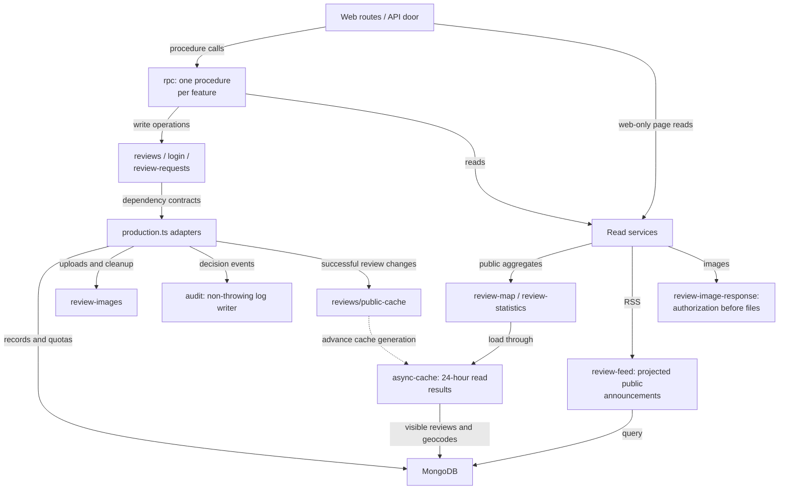
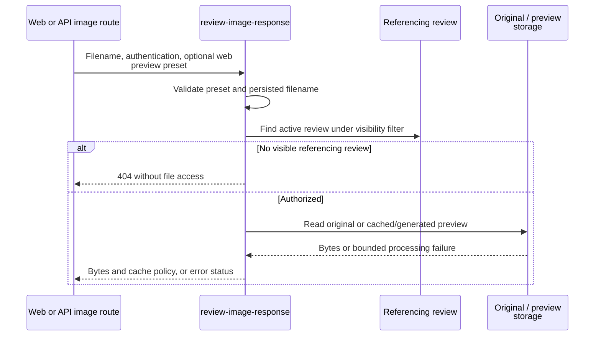

# Server workflows and services

This directory owns application workflows, security helpers, image handling, and public read
services. Every feature that the web and the API share is an oRPC procedure in [rpc/](rpc/README.md):
web routes call it server-side and the API serves it over HTTP. Workflows return results and
accept narrow dependencies; production composition connects those dependencies to MongoDB,
files, and external delivery.

[Library boundaries](../README.md) · [Routes](../../routes/README.md) ·
[Architecture and rule-to-test index](../../../docs/architecture.md)

## Subsystem responsibilities

| Owner                                                                                        | Responsibility                                                                          |
| -------------------------------------------------------------------------------------------- | --------------------------------------------------------------------------------------- |
| [reviews/](reviews/README.md)                                                                | Create, edit, publish, delete, authorship, history, and production wiring               |
| [rpc/](rpc/README.md)                                                                        | One procedure per feature for web and API; contract generation, problems, preconditions |
| [login/](login/README.md), [auth.ts](auth.ts)                                                | Credential workflow and Lucia user/session storage                                      |
| [review-requests/](review-requests/README.md)                                                | Submission validation, quotas, Discord delivery or development sink                     |
| [map/](map/README.md), [review-map.ts](review-map.ts)                                        | Persisted marker reads and separately admitted geocoding                                |
| [rate-limit.ts](rate-limit.ts), [review-request-rate-limit.ts](review-request-rate-limit.ts) | Distinct Mongo-backed quota policies                                                    |
| [request.ts](request.ts), [audit.ts](audit.ts)                                               | Trusted-proxy IP extraction and safe audit persistence                                  |
| [review-publication.ts](review-publication.ts), [review-deletion.ts](review-deletion.ts)     | Shared visibility filters and atomic state changes                                      |
| [review-statistics.ts](review-statistics.ts), [review-feed.ts](review-feed.ts)               | Public aggregate statistics and RSS generation                                          |

[async-cache.ts](async-cache.ts) shares pending reads, starts expiry after a load completes, and
uses generations so invalidated work cannot refill a newer cache. Public map/statistics caches
are process-local and last 24 hours. Successful publication, public edits, and deletion invalidate
both; draft creation/edits do not. Successful geocoding invalidates the map cache only.
RSS instead uses HTTP validators and five-minute response caching, with no process cache.

## Image reads

[review-images.ts](review-images.ts) validates/re-encodes uploads and strips metadata.
[review-image-previews.ts](review-image-previews.ts) creates versioned WebP derivatives with atomic
disk writes, shared pending jobs, and capacity limits. Originals and derivatives live outside
public static storage. Even a cached preview requires authorization first. Published/legacy images
use immutable public caching; other authorized states use private, no-store caching. Deleted or
unreferenced images return 404, though clients may retain earlier public copies. Native API image
requests accept the same preview presets as the web route. Detailed limits belong to the [security guide](../../../docs/agents/security.md#images).

Start verification with [image response tests](review-image-response.test.ts),
[cache tests](async-cache.test.ts), [audit tests](audit.test.ts), and
[statistics tests](review-statistics.test.ts).
