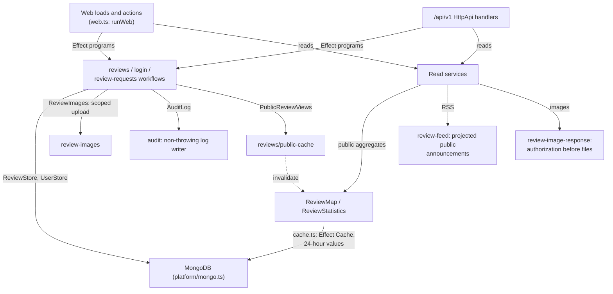
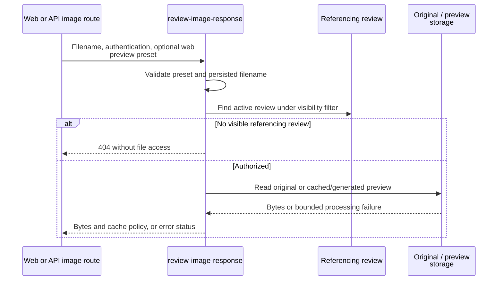

# Server workflows and services

This directory owns application workflows, security helpers, image handling, and public read
services, written with Effect 4. Workflows are Effect programs that fail with typed
`Schema.TaggedError`s; the services they use (stores, audit log, quotas, images, caches, external
delivery) are `Context.Service`s with production and test layers. Routes and API handlers run them
on one shared runtime.

[Library boundaries](../README.md) · [Routes](../../routes/README.md) ·
[Runtime, config, and MongoDB](platform/README.md) ·
[Architecture and rule-to-test index](../../../docs/architecture.md)

## Subsystem responsibilities



| Owner                                                                                        | Responsibility                                                                                     |
| -------------------------------------------------------------------------------------------- | -------------------------------------------------------------------------------------------------- |
| [platform/](platform/README.md)                                                              | `AppConfig`, `Mongo`, the layer graph, and the shared `ManagedRuntime`                             |
| [web.ts](web.ts)                                                                             | `runWeb`/`runWebAsUser` for loads and actions, and the typed-error to `fail()`/`error()` mapping   |
| [errors.ts](errors.ts)                                                                       | The tagged domain errors with their HTTP status and Swedish message                                |
| [reviews/](reviews/README.md)                                                                | Create, edit, publish, delete, authorship, history, listings, and the review store                 |
| [api/](api/README.md)                                                                        | The `HttpApi` definition, handlers, middleware, transport helpers, and OpenAPI generation          |
| [login/](login/README.md), [auth.ts](auth.ts)                                                | Credential workflow and the `Sessions` service (Lucia user/session storage)                        |
| [review-requests/](review-requests/README.md)                                                | Submission validation, quotas, Discord delivery or development sink                                |
| [map/](map/README.md)                                                                        | `ReviewMap` (persisted marker reads) and the `Geocoder` (admitted, rate-spaced Nominatim lookups)  |
| [rate-limit.ts](rate-limit.ts), [review-request-rate-limit.ts](review-request-rate-limit.ts) | Distinct Mongo-backed quota policies as services                                                   |
| [request.ts](request.ts), [audit.ts](audit.ts)                                               | `RequestContext`, `Viewer`, `CurrentUser`, trusted-proxy IP extraction, and safe audit persistence |
| [review-publication.ts](review-publication.ts), [review-deletion.ts](review-deletion.ts)     | Shared visibility filters and atomic state changes                                                 |
| [review-statistics.ts](review-statistics.ts), [review-feed.ts](review-feed.ts)               | Public aggregate statistics and RSS generation                                                     |
| [testing.ts](testing.ts)                                                                     | In-memory test layers (`makeTestWorld`, `makeTestAppLayer`, `useTestApp`, `runWorkflow`)           |

[cache.ts](cache.ts) wraps Effect `Cache` as one process-wide value: concurrent reads share one
pending load, failures are not cached, the time to live starts when a load completes, and an
invalidated load cannot refill the cache. Public map/statistics caches last 24 hours. Successful
publication, public edits, and deletion invalidate both; draft creation/edits do not. Successful
geocoding invalidates the map cache only. RSS instead uses HTTP validators and five-minute response
caching, with no process cache.

External calls have timeouts: Nominatim 10 seconds, Discord 5 seconds. A failed call is a typed
error, never a hung request.

## Writing a workflow

A workflow is an `Effect.fn` that reads its context from services: `CurrentUser` and
`RequestContext` for who and where, and the stores and other services for I/O. It fails with
errors from [errors.ts](errors.ts) and never builds HTTP responses. Its requirements show in its
type, so a missing service is a compile error rather than a runtime surprise.

```ts
export const deleteReview = Effect.fn('deleteReview')(function* (slug, options) {
	const { username } = yield* CurrentUser;
	const store = yield* ReviewStore;
	// ... audit, softDelete, invalidate public views
	if (result.outcome === 'conflict') return yield* ConcurrentUpdate.default();
});
```

Test it with `runWorkflow(world, effect)` from [testing.ts](testing.ts), then assert on the exit and
on the world. Test routes and endpoints with `useTestApp` and `makeApiHandler(makeTestAppLayer(...))`.

## Image reads



[review-images.ts](review-images.ts) validates/re-encodes uploads and strips metadata.
[review-image-previews.ts](review-image-previews.ts) creates versioned WebP derivatives with atomic
disk writes, shared pending jobs, and capacity limits. Originals and derivatives live outside
public static storage. Even a cached preview requires authorization first. Published/legacy images
use immutable public caching; other authorized states use private, no-store caching. Deleted or
unreferenced images return 404, though clients may retain earlier public copies. Native API image
requests accept the same preview presets as the web route. Detailed limits belong to the [security guide](../../../docs/agents/security.md#images).

Image uploads are scoped: `ReviewImages.upload` writes the file with `Effect.acquireRelease`, and
the release removes it again when the surrounding workflow fails, so a failed insert or a
conflicting edit never leaves an orphaned file.

Start verification with [image response tests](review-image-response.test.ts),
[image tests](review-images.test.ts), [cache tests](cache.test.ts), [audit tests](audit.test.ts),
and [statistics tests](review-statistics.test.ts).
