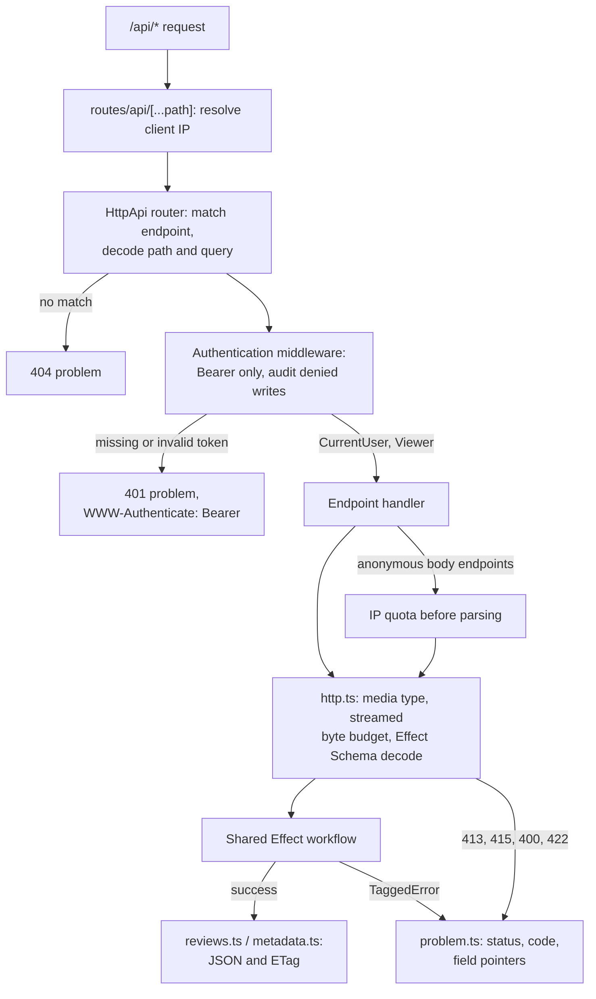
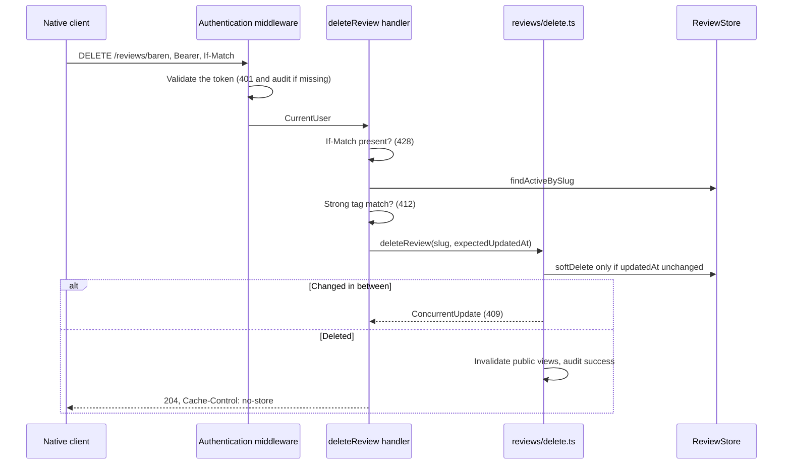

# Native API

This directory is the `/api/v1` HTTP API: the Effect `HttpApi` definition, its handlers, and the
transport helpers. It owns authentication middleware, JSON decoding, body budgets, API
representations, conditional headers, and problem responses. The domain rules live in the shared
workflows; a handler only adapts HTTP to them.

[Server overview](../README.md) · [Contract and generation](../../../../openapi/README.md) ·
[API decisions](../../../../docs/api.md) · [Catch-all route](../../../routes/api/[...path]/+server.ts)

## Pieces

| File                                                                                         | Role                                                                                                                                                          |
| -------------------------------------------------------------------------------------------- | ------------------------------------------------------------------------------------------------------------------------------------------------------------- |
| [contract/schemas.ts](contract/schemas.ts)                                                   | Effect schemas for every request and response component, with `x-max-body-bytes` on request bodies.                                                           |
| [contract/api.ts](contract/api.ts)                                                           | `EnStorStarkApi`: groups, endpoints, error schemas, the `Authentication` (bearer) and `OptionalAuthentication` middlewares, and the `DeniedAudit` annotation. |
| [handlers.ts](handlers.ts)                                                                   | The middleware implementations and one `handleRaw` handler per endpoint.                                                                                      |
| [server.ts](server.ts)                                                                       | `makeApiHandler(layer)`: builds the web handler and renders unknown paths, bad parameters, and defects as problems.                                           |
| [http.ts](http.ts)                                                                           | Streamed body reading with byte budgets, schema decoding with field errors, ETags, and `If-Match`/`If-None-Match`.                                            |
| [problem.ts](problem.ts)                                                                     | Maps tagged workflow errors to RFC 9457 problems with a stable `code`.                                                                                        |
| [review-input.ts](review-input.ts)                                                           | Base64 validation and the JSON-to-`FormData` mapping for review writes.                                                                                       |
| [reviews.ts](reviews.ts), [metadata.ts](metadata.ts), [nearby-reviews.ts](nearby-reviews.ts) | API representations.                                                                                                                                          |
| [openapi.ts](openapi.ts)                                                                     | Generates `openapi/v1.yaml` from the `HttpApi` and keeps it compatible with the hand-written contract the native clients were built against.                  |

## Request pipeline

Cookie sessions never authorize API requests: hooks skip `/api/*`, and the middlewares read only
`Authorization: Bearer`. Public review, history, and image reads use the same visibility rules as
web pages; a bearer session reveals active drafts. Mutations, user listing, nearby comparison, and
geocoding require a bearer session. Session creation and review requests charge the IP quota
before reading the body, then pass that admission into the shared workflow so it is charged once.

Handlers use `handleRaw` and read the body themselves, so the IP quota runs before parsing and the
400/413/415/422 bodies match the contract. The contract's path and query schemas are decoded by the
router; parameters that fail them answer 400.

## Example: deleting a review

The web action in `routes/[slug]/+page.server.ts` runs the same `deleteReview` through
`runWebAsUser` and turns the same errors into `fail()`. The endpoint test
[delete-review.test.ts](delete-review.test.ts) drives the real handler over test layers.

GET cache validation supports weak tags and wildcards. Responses vary on `Authorization`, and
authenticated cacheable representations stay private. Write responses and problems default to
`no-store`. Requests are validated at runtime; responses are checked by the Playwright Ajv tests.

See [endpoint tests](endpoints.test.ts), [server tests](server.test.ts),
[contract tests](contract.test.ts), [OpenAPI tests](openapi.test.ts), [HTTP helper tests](http.test.ts),
[input tests](review-input.test.ts), and [API integration tests](../../../../tests/api.test.ts).
