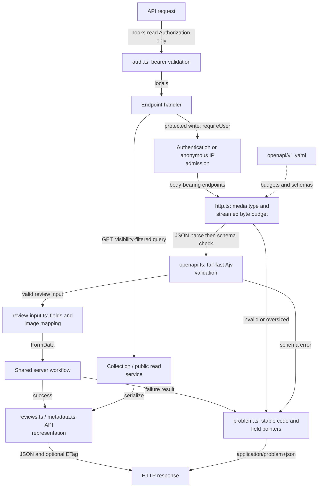
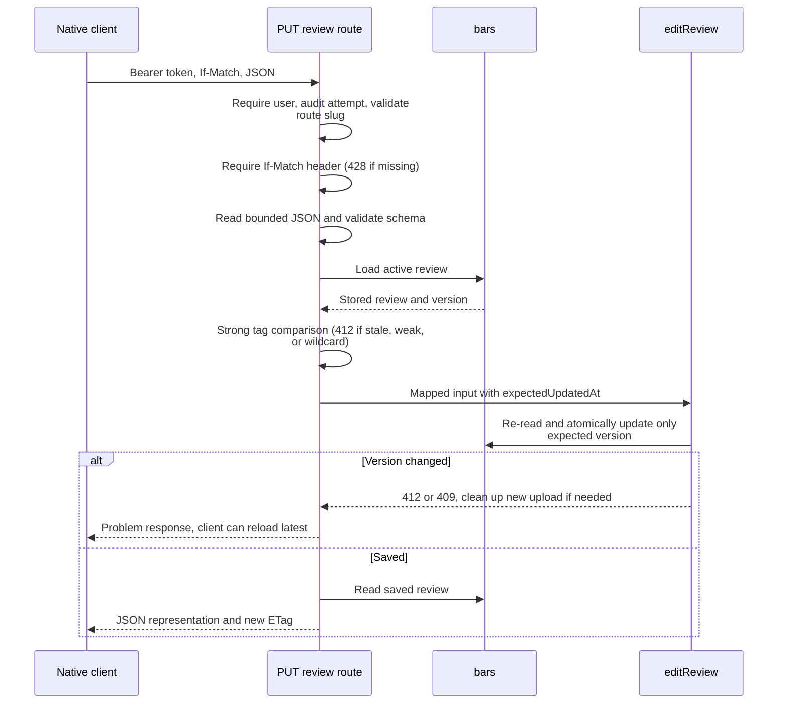

# Native API transport

This directory adapts the `/api/v1` HTTP contract to shared application workflows. It owns JSON
validation, body budgets, API representations, conditional headers, and problem responses.
The endpoint handlers themselves live under the route tree.

[Server overview](../README.md) · [Contract and generation](../../../../openapi/README.md) ·
[API decisions](../../../../docs/api.md) · [Endpoint routes](../../../routes/api/v1/)

## Request and response pipeline

Cookie sessions never authorize API requests. Public review/detail/history/image reads use the
same visibility rules as web pages; a bearer session reveals active drafts. Mutations, user
listing, and geocoding require a bearer session. Session creation and review requests consume IP
quota before body parsing and pass a server-owned admission into shared workflows to avoid charging
twice. Endpoints without bodies bypass JSON parsing.

[http.ts](http.ts) counts streamed bytes before parsing and separates strong update preconditions
from weak cache validation. [openapi.ts](openapi.ts) loads the contract schemas.
[review-input.ts](review-input.ts) validates base64 and maps JSON into shared form input;
[reviews.ts](reviews.ts) maps stored documents into public API representations.
[metadata.ts](metadata.ts) exposes form options and limits.

## Editing with a version

GET cache validation supports weak tags and wildcards. Responses vary on `Authorization`, and
authenticated cacheable representations stay private. Write responses and problems default to
`no-store`. Runtime validation covers requests; generated response types do not themselves validate
responses at runtime.

See [contract tests](contract.test.ts), [HTTP helper tests](http.test.ts),
[input tests](review-input.test.ts), and [API integration tests](../../../../tests/api.test.ts).
