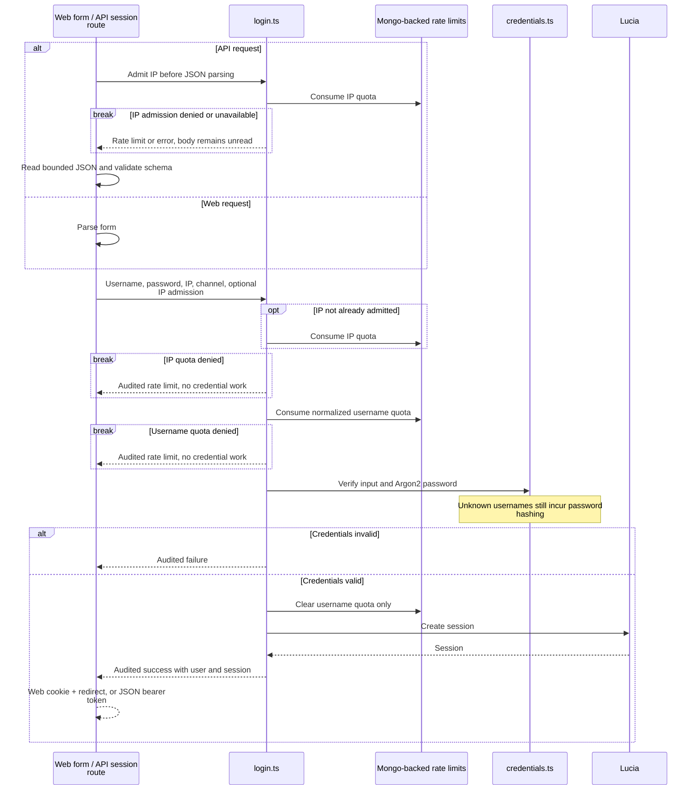

# Shared password login

This directory owns credential verification and the login workflow used by both web and native
clients. Routes retain transport responsibilities: form/JSON parsing, cookies or bearer responses,
redirects, and HTTP errors.

[Server overview](../README.md) · [API transport](../api/README.md) ·
[Security policy](../../../../docs/agents/security.md)

Each denied quota stops the sequence before credential work. Login limits are shared across web
and API: both IP and username allow eight attempts per 15-minute window/block. Successful login
does not reset the IP quota. The server-owned API admission is IP-bound and never comes from JSON.

[login.ts](login.ts) sequences limits, verification, session creation, and audit events.
[credentials.ts](credentials.ts) handles user lookup and password checks.
[production.ts](production.ts) wires MongoDB, Lucia, and auditing.
[policy.js](policy.js) is also imported by the [user creation script](../../../../scripts/create-user.js),
so pre-created users and login share credential policy. There is no public sign-up.

The API returns a session ID as a bearer token; web login sets a session cookie. Later requests
are validated in [hooks.server.ts](../../../hooks.server.ts), not by rerunning password login.
Audit events exclude passwords and tokens. Audit storage failures do not break requests; quota
storage failure must not allow credential work to proceed.

Verification: [workflow tests](login.test.ts), [credential tests](credentials.test.ts),
[API door session tests](../rpc/http.test.ts), and
[browser cookie tests](../../../../tests/session-cookies.test.ts).
