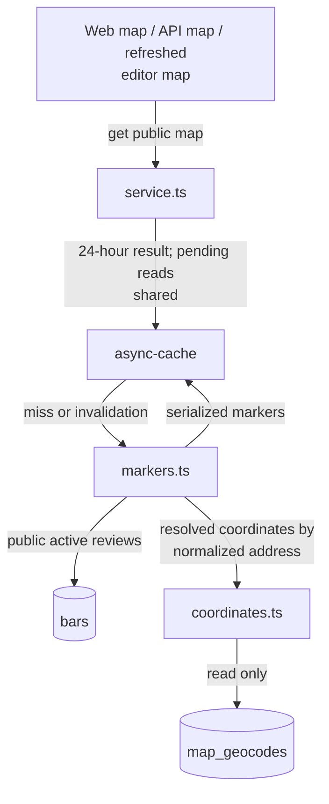
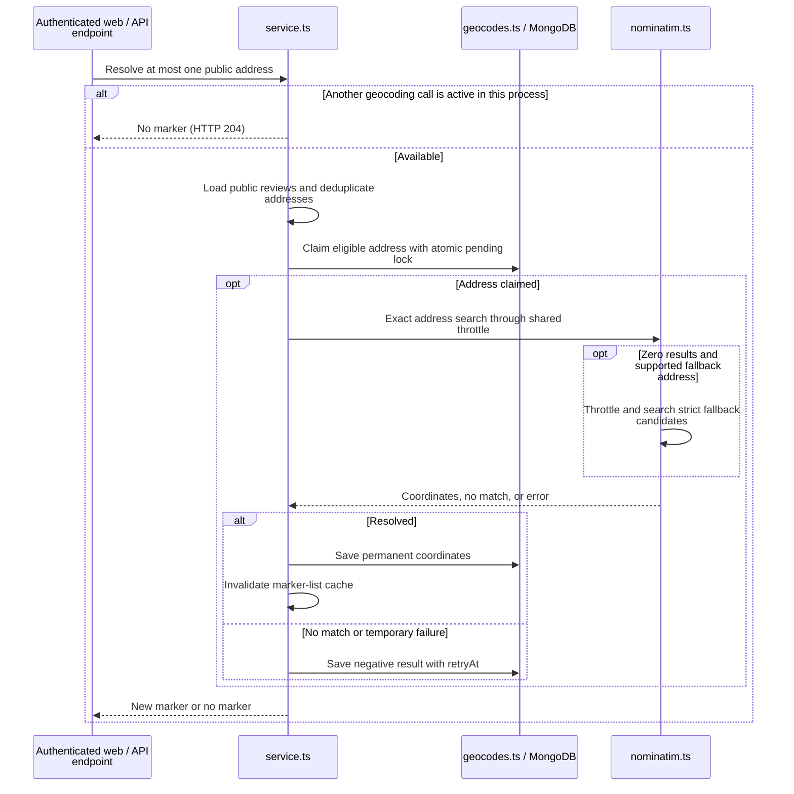

# Map reads and geocoding

This directory separates stored map reads from external address lookup. It owns address matching,
Nominatim transport, persisted geocode claims/results, marker serialization, and coordination.
[review-map.ts](../review-map.ts) composes one production service per Node process.

[Server overview](../README.md) · [Browser map](../../components/README.md#map-and-visitor-preferences) ·
[Detailed map policy](../../../../docs/agents/map.md)

## Read cached markers

Marker reads never call Nominatim. Expiry rebuilds the list from persisted data, not a bulk address
refresh. Home/detail distances and review guidance reuse saved coordinates through the read-only
coordinate loader. Missing coordinates can omit a marker without making the review invalid.

## Resolve one address

[service.ts](service.ts) returns no result to concurrent geocoding callers rather than sharing the
first caller's marker. [geocodes.ts](geocodes.ts) also uses persisted address claims to prevent
duplicate work. Resolved entries are permanent; current-strategy `not_found` retries after 30 days,
`failed` after one hour. Older negative strategy versions can become eligible once earlier.

[nominatim.ts](nominatim.ts) allows at most two searches per address attempt, at least one second
apart. A transport/API error stops the attempt; only zero exact results permit the address fallback.
[address.ts](address.ts) validates the fallback's road, house number, locality, and supplied postcode.
The web endpoint additionally requires a same-origin request. Neither transport accepts visitor GPS
coordinates for geocoding; the browser uses its location only for local display/comparisons.

Check [service tests](service.test.ts), [coordinate tests](coordinates.test.ts), and
[browser map tests](../../../../tests/review-map.test.ts). Timing and retry constants live in
[policy.ts](policy.ts).
