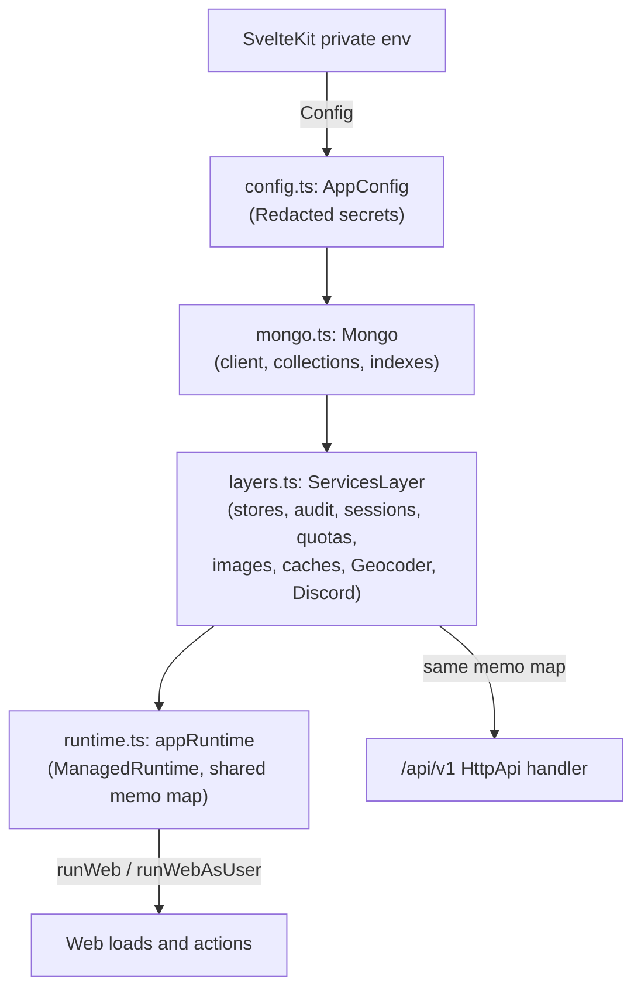
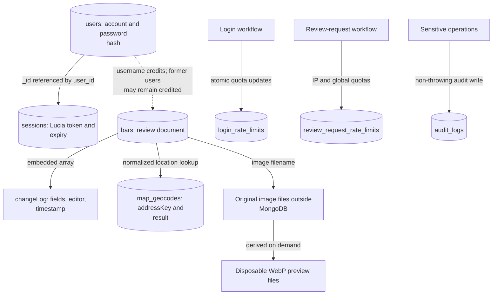

# Platform: runtime, configuration, and MongoDB

This directory builds the Effect runtime that every server request runs on: configuration from the
environment, the MongoDB client and typed collections, and the layer graph of application
services. Browser code never imports it.

[Server workflows](../README.md) · [Database container and seeding](../../../../db/README.md) ·
[Architecture](../../../../docs/architecture.md)

## Layers and the runtime

[config.ts](config.ts) reads `MONGO_URI`, `NODE_ENV`, `TRUST_PROXY`, `REVIEW_IMAGE_DIR`, and
`REVIEW_REQUEST_DISCORD_WEBHOOK_URL` once through Effect `Config`. The Mongo URI and the webhook stay
`Redacted`, so a logged configuration does not leak them. A missing `MONGO_URI` fails the runtime
build (at boot and on each request until fixed) instead of failing at module import.

[layers.ts](layers.ts) composes `ServicesLayer` from each service's own `layer`, and `makeAppLayer`
adds `Mongo` and `AppConfig`. [runtime.ts](runtime.ts) makes one `ManagedRuntime` from it. The API
handler builds its layer with the same memo map, so web and API share one MongoDB client, one set of
public caches, and one geocoding slot. Tests swap the runtime with `useTestRuntime` (normally
through `useTestApp` in [testing.ts](../testing.ts)).

## MongoDB

[mongo.ts](mongo.ts) owns the client (`acquireRelease` closes it with the runtime), the typed
`Collections`, `tryMongo` (every driver call becomes a `MongoError`, whose cause is logged and never
sent to a client), and `Mongo.layerTest` for unit tests: it serves only the collection operations a
test supplies and throws on anything else. The client connects in the background at boot and then
creates the indexes: the unique review slug and geocode address, the non-unique image lookup, the
audit lookup and 90-day TTL, the login-limit 30-day TTL, and the review-request-limit 48-hour TTL.
Initial demo accounts and baseline indexes come from the separate database image's
[init.js](../../../../db/init.js) on a fresh volume.

### Stored data

The arrows describe application references and lookups, not enforced foreign keys.

Collections are reached through services, not imported: `ReviewStore`
([reviews/store.ts](../reviews/store.ts)) and `UserStore` ([users.ts](../users.ts)) wrap the review
and user queries with their visibility filters; audit, quotas, sessions, and geocodes use their
own collections. [Review types](../../types/bar-review.ts) describe embedded history, credits,
publication, and deletion.

Reviews reference authors by username, so deleting an account does not erase historic credit.
Geocodes are matched by normalized address rather than review ID. A review stores a photo filename,
not its bytes; image serving checks a visible referencing review before file access. Missing
publication status means legacy public content; unknown statuses are excluded from public reads.
`deletedAt` hides a review without removing its document, history, or image. See
[store tests](../reviews/store.test.ts), [publication rules and tests](../review-publication.test.ts),
[deletion tests](../review-deletion.test.ts), and
[database-backed integration fixtures](../../../../tests/fixtures/reviews.ts).
