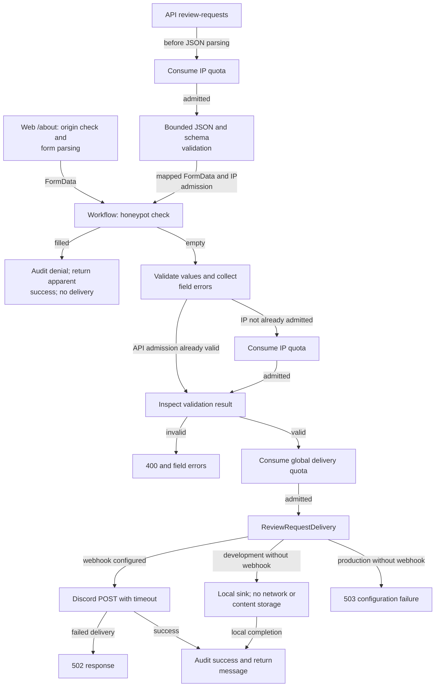

# Review-request submissions

This directory handles suggestions for bars to review. It validates form values, enforces quotas,
delivers to Discord or a development sink, and returns results for web/API routes to present.
It does not create review documents.

[Server overview](../README.md) · [Review policies](../../../../docs/agents/reviews.md#review-requests) ·
[API transport](../api/README.md)

Every denied quota exits before delivery with `429` and a retry delay. Rate-limit storage failure
returns `503`. API IP admission occurs before any body parsing, so malformed input consumes IP
quota. For web forms, the workflow checks the honeypot, computes validation, and consumes IP quota
before returning validation errors. Invalid input never consumes the global delivery quota.

[submit.ts](submit.ts) sequences the operation; [validation.ts](validation.ts) owns value limits
and the honeypot; [policy.ts](policy.ts) defines five requests per IP/day and 30 deliveries/hour.
`submitReviewRequest(data, { ipAdmission })` uses the `ReviewRequestRateLimiter`,
`ReviewRequestDelivery`, and `AuditLog` services, and fails with `ReviewRequestInvalid` (422 on the
API, 400 with field errors on the web form), `RateLimited`, or the delivery errors.
[delivery.ts](delivery.ts) is the `ReviewRequestDelivery` service: it builds the Discord payload
with mentions disabled, does not retry, and times out after five seconds. Its `layer` reads the
webhook from `AppConfig` (redacted); `layerTest` records submissions in memory. Webhook credentials
and submitted content do not belong in audit logs. The route maps results and sets `Retry-After`
where supplied.

See [validation tests](validation.test.ts), [delivery tests](delivery.test.ts),
[API tests](../api/server.test.ts), [web form tests](../../../routes/about/page.server.test.ts), and
[browser request tests](../../../../tests/review-request.test.ts). Automated delivery uses mocks,
never a real webhook.
