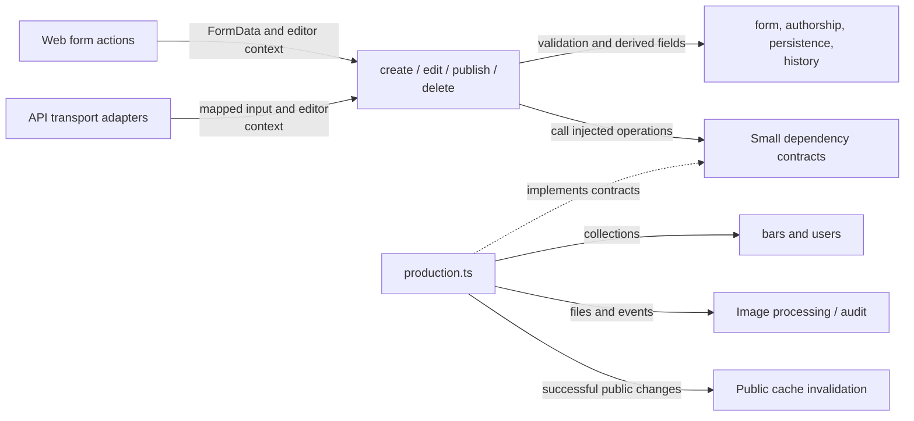
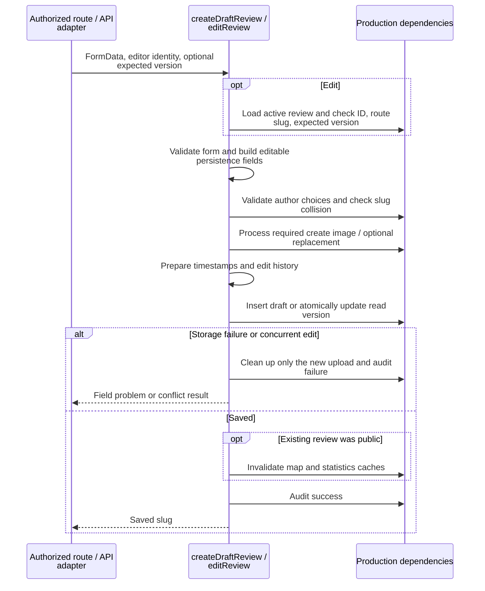
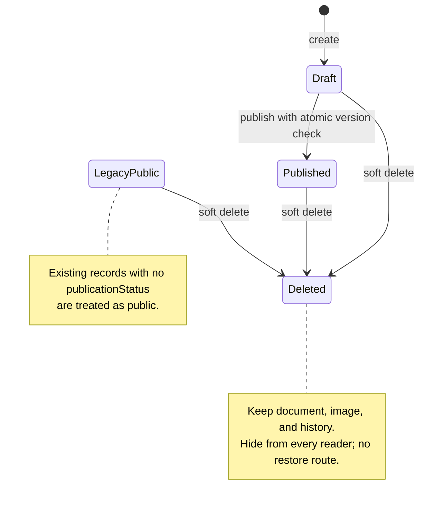

# Review workflows

This directory sequences review writes and owns focused rules for forms, authorship, persistence,
history, and serialization. Routes authorize the caller and map workflow results to HTTP.

[Server overview](../README.md) · [Route entrypoints](../../../routes/README.md) ·
[Review policies](../../../../docs/agents/reviews.md)

## Rules and production wiring

[production.ts](production.ts) supplies complete create/edit/publish/delete dependency objects,
including operation-specific database callbacks. [write-dependencies.ts](write-dependencies.ts)
defines the create/edit seams; publish/delete define their own contracts. Tests substitute those
operations without HTTP, a live database, or image storage. Routes may still query collections
directly for page loads.

## Create and edit

[create.ts](create.ts) requires a photo and always inserts a draft. [edit.ts](edit.ts) preserves
publication status, permits retaining the existing photo, and records field changes. Validation
or collision failures return before image processing; a unique slug index also catches races.

API updates require a current strong `If-Match` tag and pass its version into the workflow.
Both transports use an atomic `updatedAt` condition; a lost race returns `409 concurrent_update`
and cleans up any new image. Web forms currently do not submit their originally displayed version,
so a form opened before an already-completed edit can overwrite that edit. See the
[API sequence](../api/README.md#editing-with-a-version) for the exact request order.

## Publication and deletion

Edits preserve the current publication state, including legacy missing status. There is no
unpublish operation. [publish.ts](publish.ts) calls the atomic publication helper,
records the publisher in history, and preserves credited authors. [delete.ts](delete.ts) calls
the atomic soft-delete helper. Both invalidate public caches after success. Unknown publication
states are excluded from public filters, and deleted records are excluded for all callers.
Any signed-in reviewer may collaborate on another review; author selection does not grant access.

Useful seams and checks: [workflow-result.ts](workflow-result.ts),
[workflows.test.ts](workflows.test.ts), [delete.test.ts](delete.test.ts),
[persistence tests](persistence.test.ts), and [browser draft tests](../../../../tests/draft-reviews.test.ts).
