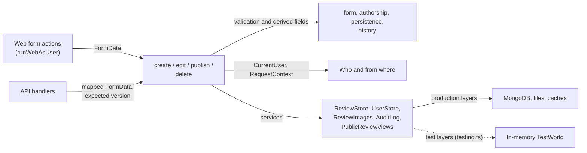
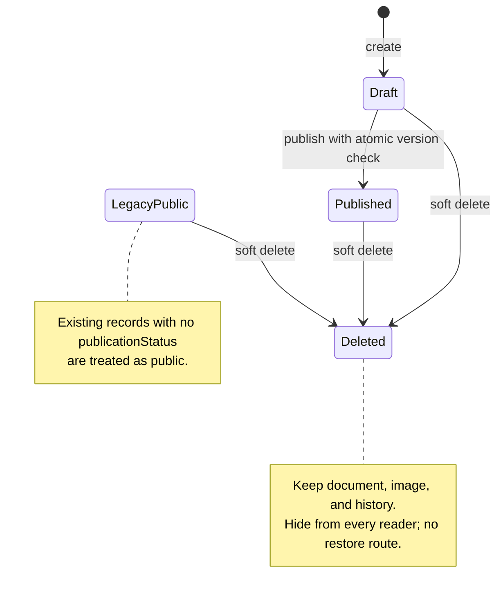

# Review workflows

This directory holds the review workflows as Effect programs and the focused rules for forms,
authorship, persistence, history, and serialization. Routes and API handlers authenticate the caller
and render workflow results and typed errors for their transport.

[Server overview](../README.md) · [Route entrypoints](../../../routes/README.md) ·
[Review policies](../../../../docs/agents/reviews.md)

## Rules and services



Each workflow is an `Effect.fn` whose type lists the services it needs and the tagged errors it can
fail with (`ReviewInvalid`, `DuplicateSlug`, `ReviewNotFound`, `ConcurrentUpdate`,
`PreconditionFailed`, `AlreadyPublished`, `StorageFailed`). [store.ts](store.ts) is the
`ReviewStore`: every query carries its visibility filter. Page loads also read through it, so
routes never query collections directly. Tests run workflows against `makeTestWorld()` with
`runWorkflow` and need no HTTP, database, or image storage.

## Create and edit

```mermaid
sequenceDiagram
    participant Route as Authorized route / API<br/>handler
    participant Write as createDraftReview /<br/>editReview
    participant Deps as Services
    Route->>Write: FormData, editor identity, optional<br/>expected version
    opt Edit
        Write->>Deps: Load active review and check ID, route<br/>slug, expected version
    end
    Write->>Write: Validate form and build editable<br/>persistence fields
    Write->>Deps: Validate author choices and check slug<br/>collision
    Write->>Deps: Process required create image / optional<br/>replacement
    Write->>Write: Prepare timestamps and edit history
    Write->>Deps: Insert draft or atomically update read<br/>version
    alt Storage failure or concurrent edit
        Write->>Deps: Scope closes with failure: the new upload<br/>is removed; audit failure
        Write-->>Route: ReviewInvalid, DuplicateSlug or<br/>ConcurrentUpdate
    else Saved
        opt Existing review was public
            Write->>Deps: Invalidate map and statistics caches
        end
        Write->>Deps: Audit success
        Write-->>Route: Saved slug
    end
```

[create.ts](create.ts) requires a photo and always inserts a draft. [edit.ts](edit.ts) preserves
publication status, permits retaining the existing photo, and records field changes. Validation
or collision failures return before image processing; a unique slug index also catches races.

API updates require a current strong `If-Match` tag and pass its version into the workflow.
Both transports use an atomic `updatedAt` condition; a lost race returns `409 concurrent_update`
and the upload scope removes any new image. The web edit form currently does not submit its
originally displayed version, so a form opened before an already-completed edit can overwrite that
edit. The edit page's delete form does submit it. See the
[API delete example](../api/README.md#example-deleting-a-review) for the request order.

## Publication and deletion



Edits preserve the current publication state, including legacy missing status. There is no
unpublish operation. [publish.ts](publish.ts) calls the atomic publication helper,
records the publisher in history, and preserves credited authors. [delete.ts](delete.ts) calls
the atomic soft-delete helper. Both invalidate public caches after success. Unknown publication
states are excluded from public filters, and deleted records are excluded for all callers.
Any signed-in reviewer may collaborate on another review; author selection does not grant access.

Useful checks: [workflows.test.ts](workflows.test.ts), [delete.test.ts](delete.test.ts),
[store tests](store.test.ts),
[persistence tests](persistence.test.ts), and [browser draft tests](../../../../tests/draft-reviews.test.ts).
