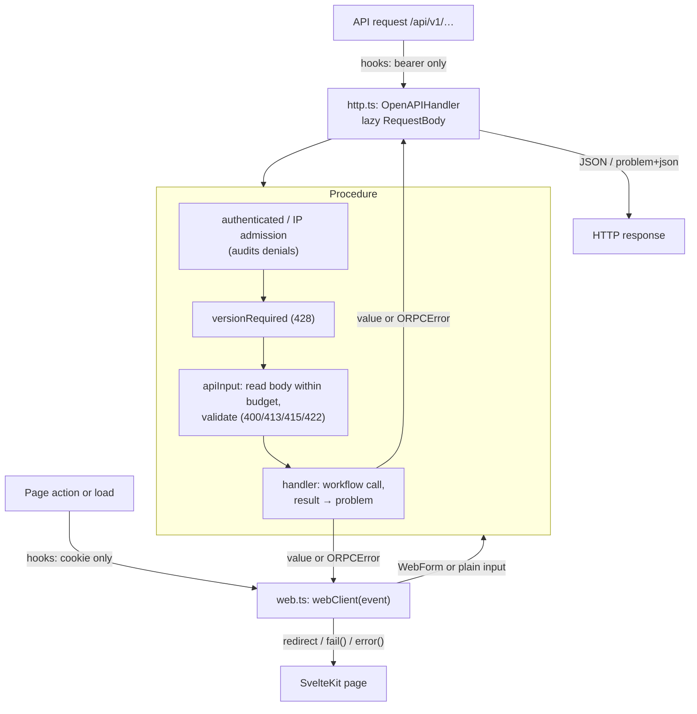

# Server features (oRPC)

Every server feature is one [oRPC](https://orpc.dev) procedure in this directory. A procedure
owns authentication, admission, input validation and the mapping of its workflow's result to a
response or a problem with a stable `code`. It calls the existing workflows in `server/reviews`,
`server/login`, `server/review-requests` and the read services; it does not reimplement them.

Each procedure has two doors:

- **API:** [http.ts](http.ts) serves the router under `/api/v1` with oRPC's OpenAPI handler,
  from the single catch-all route [`routes/api/[...path]`](../../../routes/api/%5B...path%5D/+server.ts).
- **Web:** page loads and form actions call the same procedure server-side through
  [web.ts](web.ts): `webClient(event).reviews.delete(…)`. Errors become `fail()` or `error()`.

The contract [openapi/v1.yaml](../../../../openapi/v1.yaml) is generated from the router
(`npm run api:generate`); a unit test fails when it is stale.

[Server overview](../README.md) · [API decisions](../../../../docs/api.md) ·
[Agent rules](../../../../docs/agents/api.md)

## Files

| File                                                                                                     | Owns                                                                                                   |
| -------------------------------------------------------------------------------------------------------- | ------------------------------------------------------------------------------------------------------ |
| [router.ts](router.ts)                                                                                   | The router: one entry per feature                                                                      |
| [procedures/](procedures/)                                                                               | The procedures, grouped by feature area                                                                |
| [base.ts](base.ts)                                                                                       | `base` builder, metadata (`auth`, `cache`) and shared middleware: authentication, audits, `If-Match`   |
| [context.ts](context.ts)                                                                                 | Request context (user, session, IP, channel) and the dependency interface                              |
| [production.ts](production.ts)                                                                           | Production dependencies, composed once and put on `locals.deps` by hooks                               |
| [input.ts](input.ts)                                                                                     | Detailed input (`params`, `query`, `headers`, `body`), lazy bodies, byte budgets, Swedish field errors |
| [schemas.ts](schemas.ts)                                                                                 | Zod schemas; named components of the contract                                                          |
| [errors.ts](errors.ts)                                                                                   | Problem codes, statuses and the `problem()` error constructor                                          |
| [http.ts](http.ts)                                                                                       | API door: problem+json, ETag/304, `Vary`, `no-store`, unknown paths                                    |
| [web.ts](web.ts)                                                                                         | Web door: `webClient`, `webFailure`, `webError`, `webQuery`                                            |
| [openapi.ts](openapi.ts), [openapi-yaml.ts](openapi-yaml.ts), [schema-docs.ts](schema-docs.ts)           | Contract generation                                                                                    |
| [representations.ts](representations.ts), [review-input.ts](review-input.ts), [metadata.ts](metadata.ts) | API representations and JSON → form mapping                                                            |
| [auth.ts](auth.ts)                                                                                       | Bearer token parsing for hooks                                                                         |
| [test-fixtures.ts](test-fixtures.ts)                                                                     | Fake dependencies and contexts for procedure tests                                                     |

## One request through either door

### Why the body is read inside input validation

oRPC's OpenAPI codec decodes the request body before any middleware runs. The contract needs
authentication, anonymous IP admission and the `If-Match` check before a single body byte is
read, so the API door hands procedures a lazy `RequestBody` and `apiInput()` reads it during
oRPC's input validation, which runs after the middleware declared before `.input()`. This is the
main piece of custom code; everything else uses oRPC's routing, OpenAPI handler and generator.

The web door passes a lazy `WebForm` for multipart review forms, so they are parsed only after
authentication too. Only server code can construct one; the API door produces only `RequestBody`.

## Adding a feature

1. Write a failing procedure test with `call(router.x.y, input, { context: testContext() })`,
   covering the anonymous, invalid and success paths.
2. Add the procedure under `procedures/`, using `base`, `.meta({ auth })`, `.route({ method,
path, operationId, … })`, `.errors(problems(…))`, middleware, `.input(apiInput(…))` and
   `.output(unvalidated(Schema))`. Add it to `router.ts`.
3. Call it from the web route with `webClient(event)` when the web has the feature.
4. Run `npm run api:generate` and `npm run api:diff`, and record contract changes in
   [docs/api.md](../../../../docs/api.md).

Tests: [procedure tests](procedures/reviews.test.ts), [API door](http.test.ts),
[web door](web.test.ts), [input](input.test.ts), [preconditions](preconditions.test.ts),
[contract](openapi.test.ts), and [API integration tests](../../../../tests/api.test.ts).
