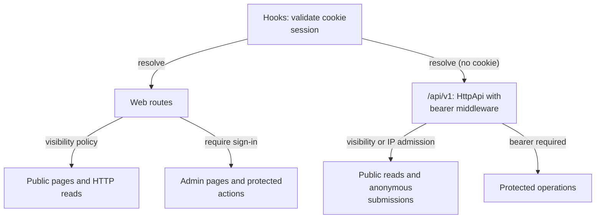
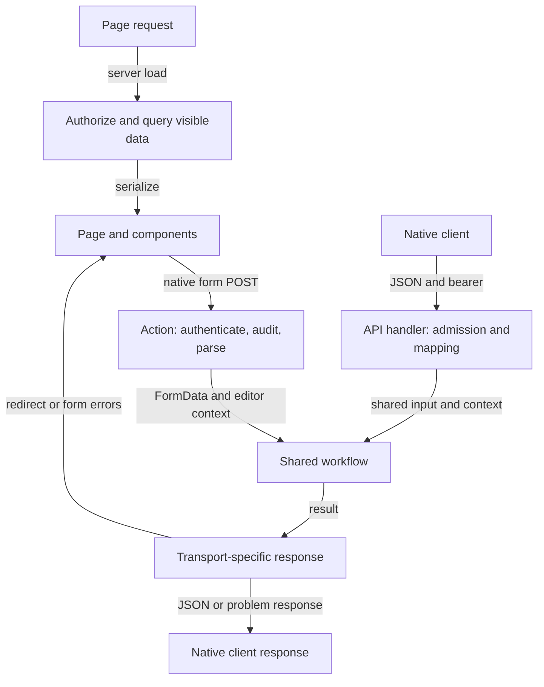

# Routes and request entrypoints

This directory maps URLs to pages, server loads, form actions, and HTTP endpoints. Routes own
authentication/admission, request parsing, and HTTP responses; they run the shared Effect
workflows through `runWeb`/`runWebAsUser` ([server/web.ts](../lib/server/web.ts)), which also turns
typed errors into `error()`, and `failWith`/`failReviewFormWith` into `fail()`. The whole `/api/v1`
API is one catch-all route, [api/[...path]](api/[...path]/+server.ts), served by the Effect `HttpApi`.

[Application lifecycle](../README.md) · [Server guide](../lib/server/README.md) ·
[API adapters](../lib/server/api/README.md)

## Route families

| Family        | Examples                                                                                                                                    |
| ------------- | ------------------------------------------------------------------------------------------------------------------------------------------- |
| Public web    | Home, review detail/history, `/karta`, `/statistik`, `/about`, `/installningar`, `/login`, RSS, and visibility-filtered images              |
| Signed-in web | Admin review list, create/edit, publish/delete actions; `/karta/next-marker` also requires same origin                                      |
| Public API    | Visible review/detail/history/image reads, map, statistics, metadata; session creation and review requests require IP admission before JSON |
| Signed-in API | Review creation/edit/publication, user listing, geocoding, current-session inspection/revocation                                            |

Public review lists and details include drafts for signed-in users. Anonymous readers see only
published or legacy missing-status reviews; deleted reviews are always excluded. Any signed-in
reviewer may edit, publish, or delete another review. Authorship records credit, not ownership.
History follows the same review visibility policy as details.

The homepage and [`/recensioner/data`](recensioner/data/+server.ts) share bounded server-side
search/filtering. The browser appends batches automatically; ordinary `?page=` links support
crawlers and visitors without JavaScript. [`/sitemap.xml`](sitemap.xml/+server.ts) always reads only
public content. See [SEO and browsing](../../docs/seo.md) for the web contract and metadata policy.

The [create wizard route](admin/reviews/create/wizard/+page.server.ts) reuses the normal create
load/action. It is an unlinked beta entrypoint, not a separate persistence workflow.
The [settings page](installningar/+page.svelte) saves browser preferences without account writes.

## Reads and writes

Follow [home loading](+page.server.ts), [review detail and actions]([slug]/+page.server.ts),
[review creation](admin/reviews/create/+page.server.ts), and
[API handlers](../lib/server/api/handlers.ts) for concrete examples. Web pages do not call
their own JSON API to perform server work. [The API contract](../../openapi/README.md) lists the
native endpoints; [API decisions](../../docs/api.md) explain their policies.

Regression entrypoints: [action tests](review-actions.test.ts),
[delete-action tests](review-delete-action.test.ts), [web page tests](web-pages.test.ts), and
[API integration tests](../../tests/api.test.ts). Route tests run on test layers with `useTestApp`
from [server/testing.ts](../lib/server/testing.ts) instead of mocking modules.
