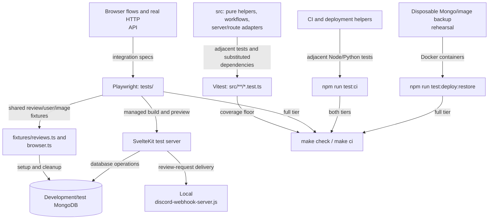

# Verification layers and integration fixtures

This directory owns Playwright browser/API integration specs and their shared fixtures. Unit tests
live beside the code they cover under `src/`; automation tests live beside scripts.

[Repository testing commands](../README.md#testing) · [Application lifecycle](../src/README.md) ·
[Rule-to-test index](../docs/architecture.md#rule-to-test-index) · [CI and deployment](../scripts/README.md)

## What each layer exercises

[playwright.config.ts](../playwright.config.ts) starts a local webhook mock and a production-built
preview bound to `127.0.0.1`, unless an external test base URL is configured. Fixtures still require
a development/test MongoDB and an appropriate image directory. For an external test server, delivery
must also be configured to use a mock. Never point shared fixtures at production or a real webhook.

## Fixtures and representative journeys

[fixtures/reviews.ts](fixtures/reviews.ts) creates reviews, users, and image files, and restores
temporarily isolated quotas. [fixtures/browser.ts](fixtures/browser.ts) provides browser helpers.
The configured single Playwright worker prevents shared quota/cache fixtures from racing.

| Journey                                                           | Representative spec                                                                                                                |
| ----------------------------------------------------------------- | ---------------------------------------------------------------------------------------------------------------------------------- |
| Draft publication and collaborative authorship                    | [draft-reviews.test.ts](draft-reviews.test.ts), [review-authorship.test.ts](review-authorship.test.ts)                             |
| Soft deletion and hidden images/history                           | [deleted-reviews.test.ts](deleted-reviews.test.ts)                                                                                 |
| Bearer isolation, input limits, preconditions, response contracts | [api.test.ts](api.test.ts)                                                                                                         |
| Form steps and validation feedback                                | [review-wizard.test.ts](review-wizard.test.ts)                                                                                     |
| Map, distances, and browser preferences                           | [review-map.test.ts](review-map.test.ts), [review-distance.test.ts](review-distance.test.ts), [settings.test.ts](settings.test.ts) |
| Image previews and upgrades                                       | [progressive-images.test.ts](progressive-images.test.ts)                                                                           |
| Public RSS and statistics                                         | [review-feed.test.ts](review-feed.test.ts), [beer-value.test.ts](beer-value.test.ts)                                               |
| Mocked review-request delivery                                    | [review-request.test.ts](review-request.test.ts)                                                                                   |

For a runtime change, reproduce the behavior with a meaningful failing regression, implement, then
run the relevant adjacent tests and repository checks. Add Playwright coverage for route/UI/workflow
changes. Documentation-only work needs link, diagram, and formatting checks rather than artificial
application tests. Native simulator verification is documented separately in
[mobile/AGENTS.md](../mobile/AGENTS.md).
